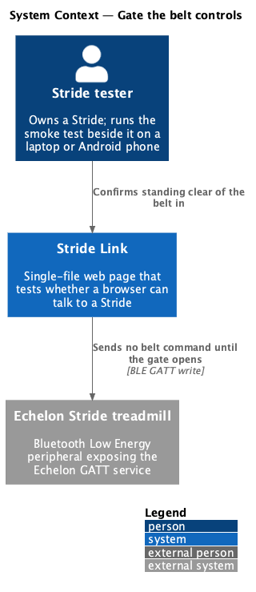
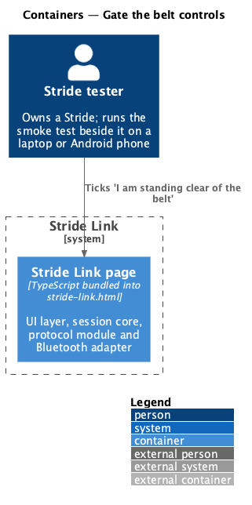
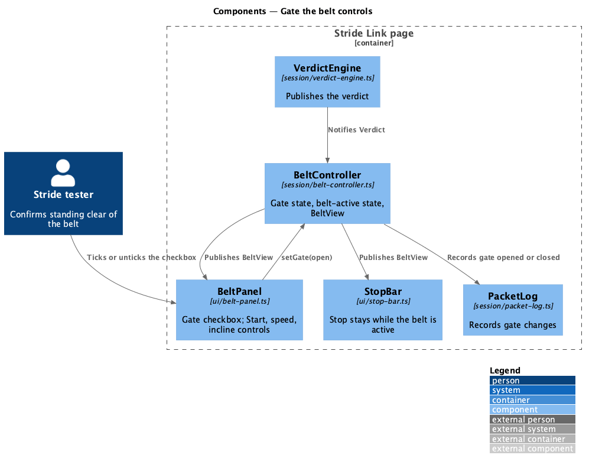
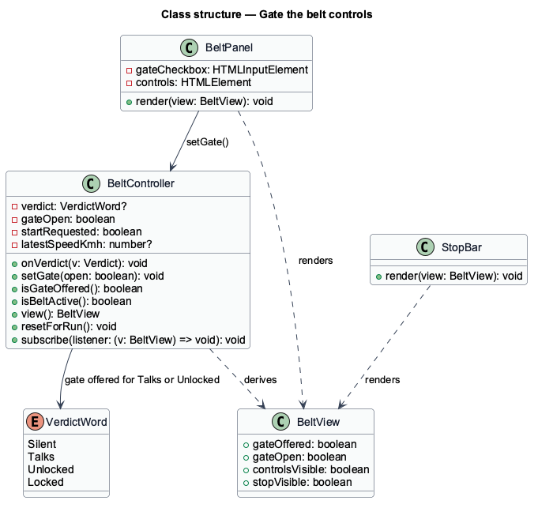
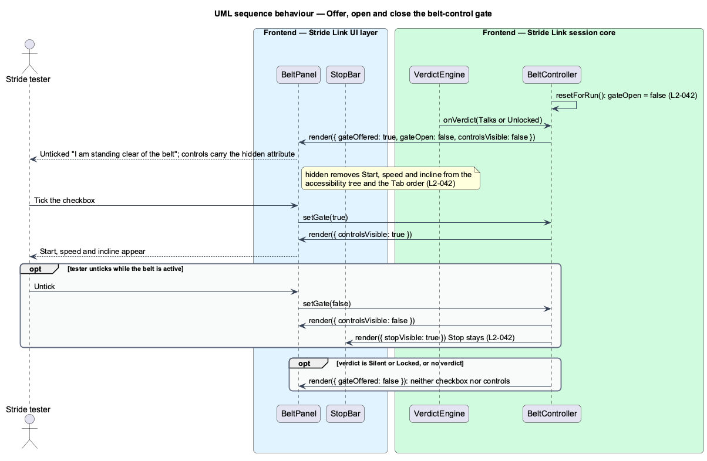

# Gate the belt controls

## Overview

A treadmill belt can move in response to a command, so belt control in Stride Link is opt-in. Belt commands are useful only once the treadmill answers. The verdict table offers them for **Talks** and **Unlocked** only.

- **gate** — checkbox labelled `I am standing clear of the belt` whose tick is the precondition for Start, speed and incline controls to exist
- **belt controls** — Start button, speed input and incline input
- **belt active** — state that holds while Start has been pressed and no Stop write has succeeded since, or while the latest decoded speed is above 0

This feature decides when the gate is offered and what ticking or unticking it does. Stop is not behind the gate. It is governed by the belt-active state in `start-and-stop-belt`.

## Description

- **`BeltController`** — holds the gate state and computes a `BeltView`:
  - `gateOffered` is true when the verdict is **Talks** or **Unlocked**.
  - `controlsVisible` is true when the gate is offered and open.
  - `stopVisible` follows `isBeltActive()`.

  `onVerdict()` updates the verdict, and a verdict that is neither **Talks** nor **Unlocked** closes the gate. `resetForRun()` unticks the gate at the start of every run. `setGate(open)` records the change in `PacketLog`.
- **`BeltView`** — `gateOffered`, `gateOpen`, `controlsVisible` and `stopVisible`.
- **`BeltPanel`** — renders the checkbox and the belt controls. Hidden controls carry the `hidden` attribute, which removes them from layout, the accessibility tree and the Tab order (L2-042).
- **`StopBar`** — renders Stop from the same `BeltView`. Unticking the gate while the belt is active hides Start, speed and incline, but Stop stays.

## Requirements

The feature realizes the following level-2 (L2) requirements. Each L2 requirement refines a level-1 (L1) requirement, cited by identifier.

| L2 ID | Refines (L1) | Requirement |
|-------|--------------|-------------|
| `L2-042` | `L1-010` | Start, speed and incline controls must not be rendered or focusable until the tester ticks `I am standing clear of the belt`. That checkbox must be offered only under a **Talks** or **Unlocked** verdict. |

## Diagrams

### System context

The tester confirms standing clear in Stride Link. No belt command reaches the treadmill before that.

### Containers

The gate lives entirely within the page and crosses no container boundary. The component view holds the detail.

### Components

`VerdictEngine` informs `BeltController`, which publishes a `BeltView` to `BeltPanel` and `StopBar`.

### Class structure

`BeltController` derives `BeltView` from the verdict, the gate and the belt-active state. Both UI parts render from it.

### Behaviour — offer, open and close the gate

The gate is offered on **Talks** or **Unlocked**. Ticking it reveals the controls. Unticking it while the belt is active keeps Stop on screen.

