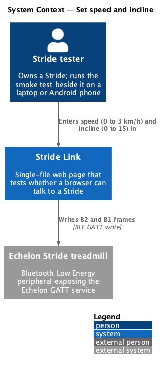
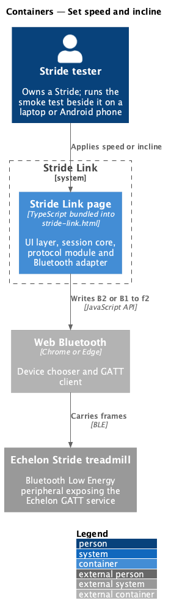
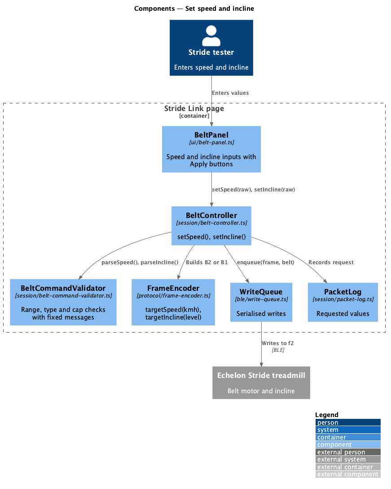
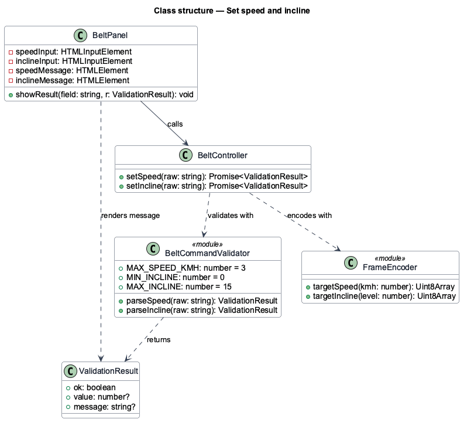
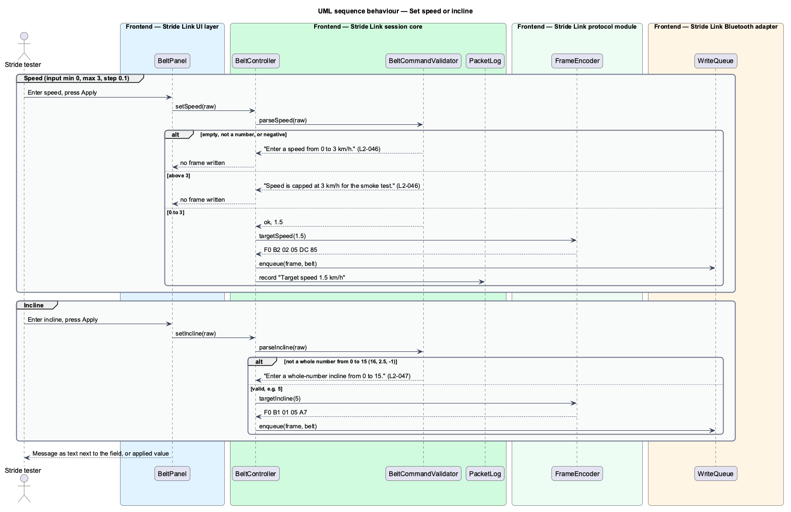

# Set speed and incline

## Overview

With the gate open, the tester can set a target speed and a target incline to check that the treadmill obeys commands.

- **target speed command** — frame `F0 B2 02 hi lo ck`, where `hi lo` is round(km/h x 1000)
- **target incline command** — frame `F0 B1 01 n ck`, where `n` is a whole number from 0 to 15
- **smoke-test speed cap** — 3 km/h, the highest target speed Stride Link sends

The cap comes from the PRD's safety section. It is enforced before any frame is built, so a value above it never reaches the queue.

## Description

- **`BeltPanel`** — a speed input (`type="number"`, `min` 0, `max` 3, `step` 0.1) and an incline input (`min` 0, `max` 15, `step` 1), each with an Apply button. `showResult()` writes the validation message or the applied value as text next to the field.
- **`BeltCommandValidator`** — pure functions with fixed messages:
  - `parseSpeed(raw)` reads `Number(raw)`. An empty value, `NaN` or a negative number gives `Enter a speed from 0 to 3 km/h.` A value above 3 gives `Speed is capped at 3 km/h for the smoke test.` Any value from 0 to 3 inclusive is accepted. The `step` attribute guides the spinner only.
  - `parseIncline(raw)` accepts integers from 0 to 15. Anything else (16, 2.5, -1) gives `Enter a whole-number incline from 0 to 15.`
- **`BeltController`** — `setSpeed(raw)` and `setIncline(raw)` validate first. On success they encode with `FrameEncoder.targetSpeed()` or `targetIncline()`, enqueue the frame tagged `belt`, and log the requested value. On failure no frame is written.
- **Examples** — 1.5 km/h gives `F0 B2 02 05 DC 85`, 3.0 km/h gives `F0 B2 02 0B B8 67`, and incline 5 gives `F0 B1 01 05 A7`.

## Requirements

The feature realizes the following level-2 (L2) requirements. Each L2 requirement refines a level-1 (L1) requirement, cited by identifier.

| L2 ID | Refines (L1) | Requirement |
|-------|--------------|-------------|
| `L2-046` | `L1-010` | The speed control must accept 0.0 to 3.0 km/h in steps of 0.1 and write `F0 B2 02 hi lo ck`, where hi lo is round(km/h x 1000). Values outside the range must be rejected without writing. |
| `L2-047` | `L1-010` | The incline control must accept whole numbers 0 to 15 and write `F0 B1 01 n ck`. |

## Diagrams

### System context

The tester enters values in Stride Link, which writes `B2` and `B1` frames to the treadmill.

### Containers

Validated commands reach the treadmill through Web Bluetooth as writes to `f2`.

### Components

`BeltPanel` passes raw input to `BeltController`, which validates with `BeltCommandValidator` before encoding and enqueueing.

### Class structure

`BeltCommandValidator` returns a `ValidationResult` that `BeltController` acts on and `BeltPanel` renders.

### Behaviour — set speed or incline

Each input is validated. Invalid values produce a fixed message and no frame. Valid values are encoded and queued.

