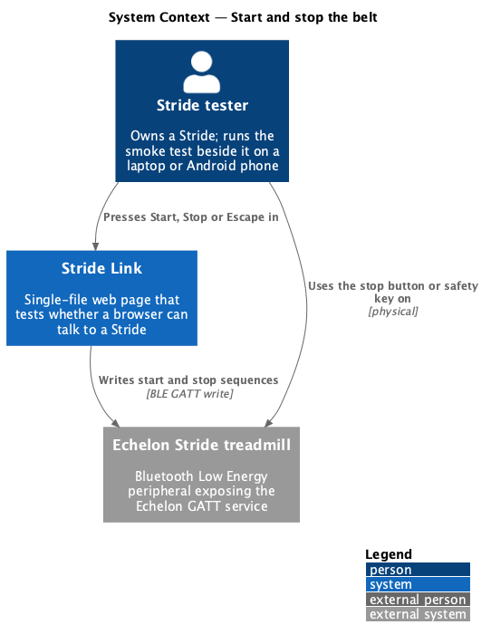
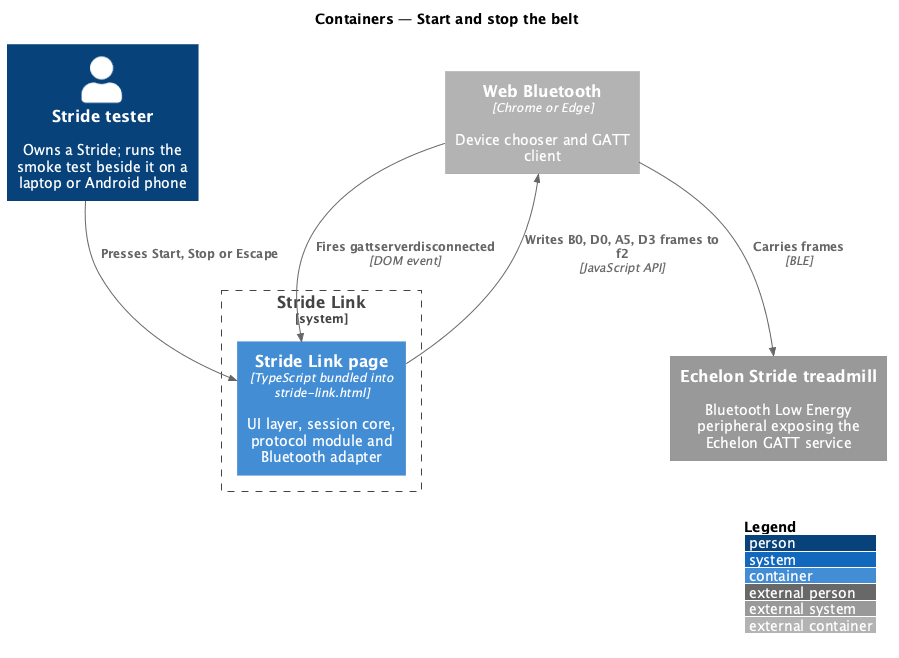
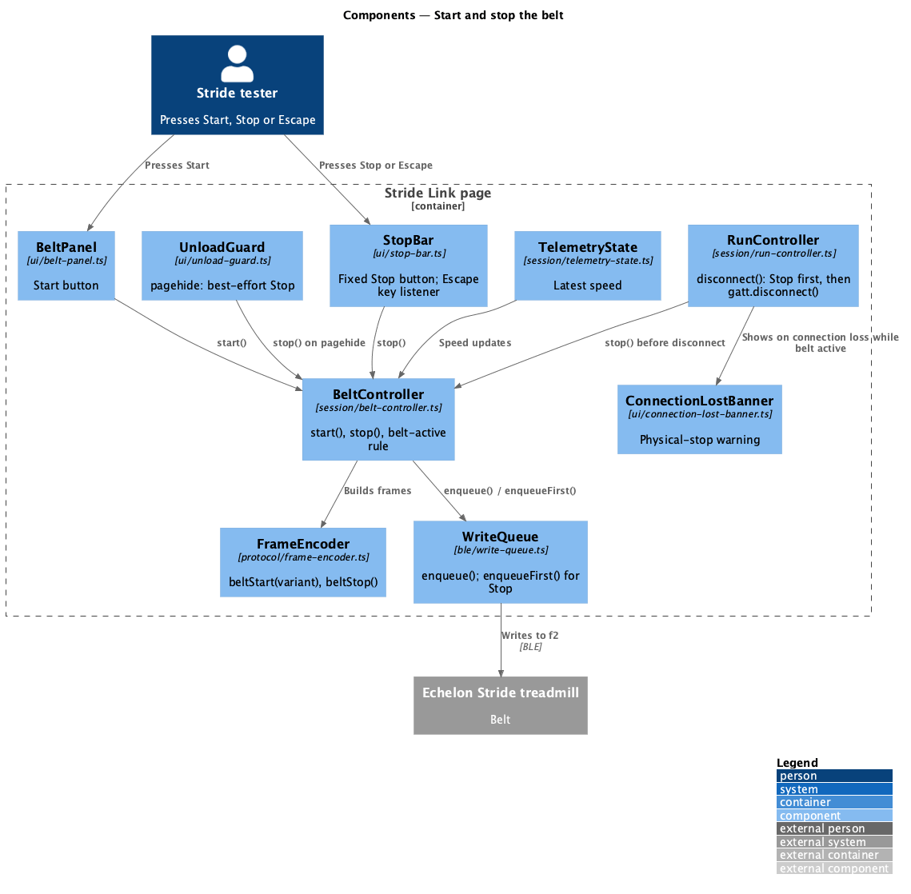
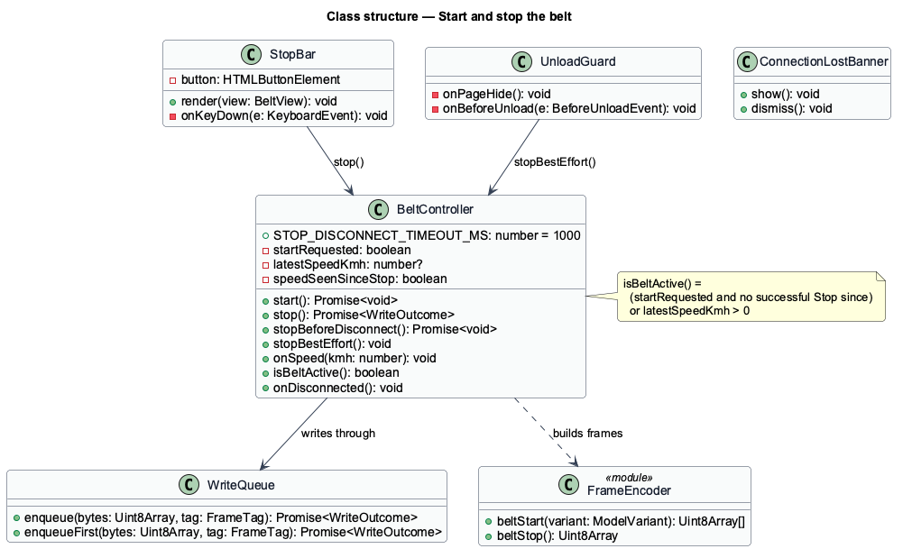
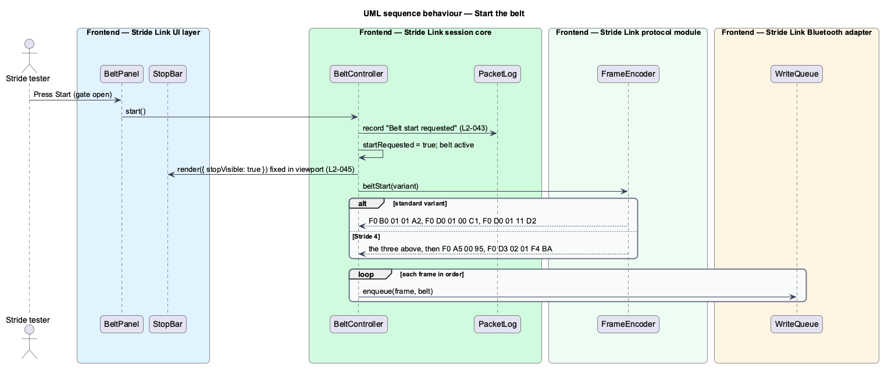
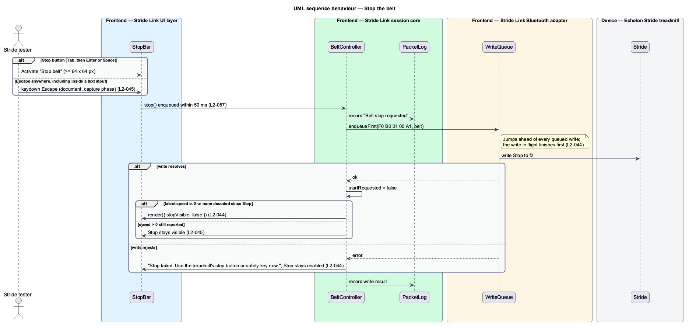
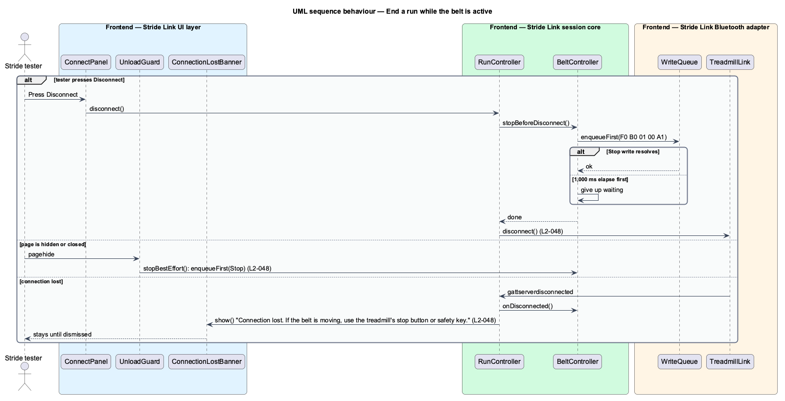

# Start and stop the belt

## Overview

Starting the belt is the one action in Stride Link that moves physical equipment. The PRD's safety rules apply in full:

- belt controls stay off until the tester confirms they are clear;
- speed is capped at 3 km/h;
- Stop is always on screen while the belt can move;
- the tester keeps the treadmill's safety key in reach;
- hardware tests are run by a person, never by CI or an agent.

- **start sequence** — frames written when the tester presses Start: `F0 B0 01 01 A2`, `F0 D0 01 00 C1`, `F0 D0 01 11 D2`, plus `F0 A5 00 95` and `F0 D3 02 01 F4 BA` on a Stride 4
- **Stop command** — frame `F0 B0 01 00 A1`
- **belt active** — state that holds while Start has been pressed and no Stop write has succeeded since, or while the latest decoded speed is above 0

The PRD lists the Stride 4 additions without an order. This design writes them after the three common frames, per L2-043.

## Description

- **`BeltController`** —
  - `start()` logs `Belt start requested`, sets `startRequested`, and enqueues the frames from `FrameEncoder.beltStart(variant)` in order, each tagged `belt`.
  - `stop()` logs `Belt stop requested` and calls `WriteQueue.enqueueFirst(beltStop())`, so Stop goes ahead of every waiting write. The write in flight finishes first, because a GATT write cannot be cancelled.
  - When the Stop write succeeds, `startRequested` clears. The belt then stays active only while decoded speed is above 0.
  - When the Stop write fails, the page shows `Stop failed. Use the treadmill's stop button or safety key now.`, and Stop stays enabled.
  - `onSpeed(kmh)` comes from `TelemetryState`. A speed above 0 makes the belt active even when Start was never pressed in this run (L2-045).
- **`StopBar`** — a button labelled `Stop belt`, at least 64 x 64 CSS px. It is rendered whenever the belt is active.
  - It is `position: fixed` inside the viewport at every width from 320 px to 1920 px: a full-width bottom bar below 768 px, and a fixed corner button above.
  - It sits in the Tab order and activates on Enter and Space.
  - A `keydown` listener on `document`, in the capture phase, turns Escape into Stop from anywhere, including text inputs.
  - Stop is enqueued within 50 ms of the key press, even after a one-hour session (L2-057).
- **`stopBeforeDisconnect()`** — used by `RunController.disconnect()` when the belt is active. It enqueues Stop first and waits for the write or 1,000 ms, whichever comes first, before `gatt.disconnect()` (L2-048).
- **`UnloadGuard`** — on `pagehide` with the belt active, calls `stopBestEffort()`, which enqueues Stop at the head of the queue. Delivery is not guaranteed once the page is unloading.
- **`ConnectionLostBanner`** — on `gattserverdisconnected` with the belt active, shows `Connection lost. If the belt is moving, use the treadmill's stop button or safety key.` until dismissed. No command can reach the treadmill at that point.

## Requirements

The feature realizes the following level-2 (L2) requirements. Each L2 requirement refines a level-1 (L1) requirement, cited by identifier.

| L2 ID | Refines (L1) | Requirement |
|-------|--------------|-------------|
| `L2-043` | `L1-010` | Start must write `F0 B0 01 01 A2`, `F0 D0 01 00 C1`, `F0 D0 01 11 D2` in order. The Stride 4 variant must then also write `F0 A5 00 95` and `F0 D3 02 01 F4 BA`. |
| `L2-044` | `L1-010` | Stop must write `F0 B0 01 00 A1` ahead of every queued write except the one in flight. |
| `L2-045` | `L1-010` | While the belt is active, Stop must stay on screen at every viewport size and scroll position, reachable by Tab, operable by Enter and Space, and triggered by Escape anywhere on the page. |
| `L2-048` | `L1-010` | Ending a run must try to stop the belt first, and losing the connection while the belt is active must tell the tester to stop it physically. |

## Diagrams

### System context

The tester starts and stops the belt through Stride Link. The treadmill's own stop button and safety key remain the physical fallback.

### Containers

Start and stop frames reach the treadmill through Web Bluetooth. A connection loss returns to the page as `gattserverdisconnected`.

### Components

Start, Stop, Escape, disconnect and `pagehide` all converge on `BeltController`. `BeltController` encodes frames and writes Stop at the head of `WriteQueue`.

### Class structure

`BeltController` owns the belt-active rule. `StopBar` and `UnloadGuard` call into it, and it writes through `WriteQueue`.

### Behaviour — start the belt

Start logs the request, shows Stop, and writes the variant's start sequence in order.

### Behaviour — stop the belt

Stop comes from the button or from Escape and jumps the queue. Its outcome decides whether Stop stays on screen.

### Behaviour — end a run while the belt is active

The diagram covers a tester disconnect, a hidden page and a lost connection, the three ways a run can end with the belt active.

