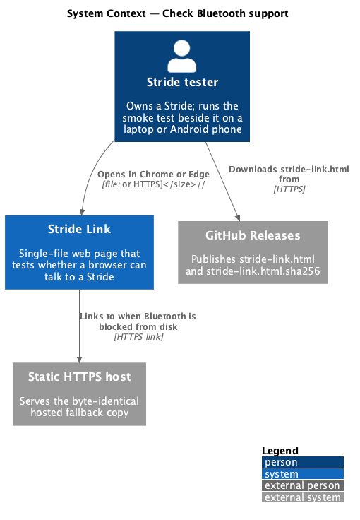
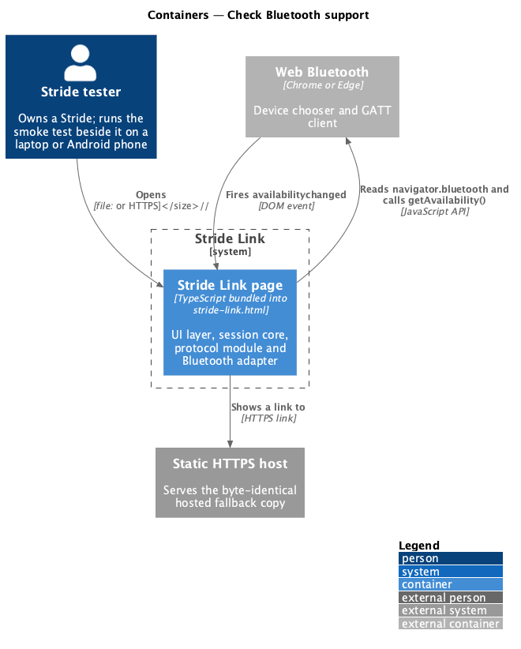
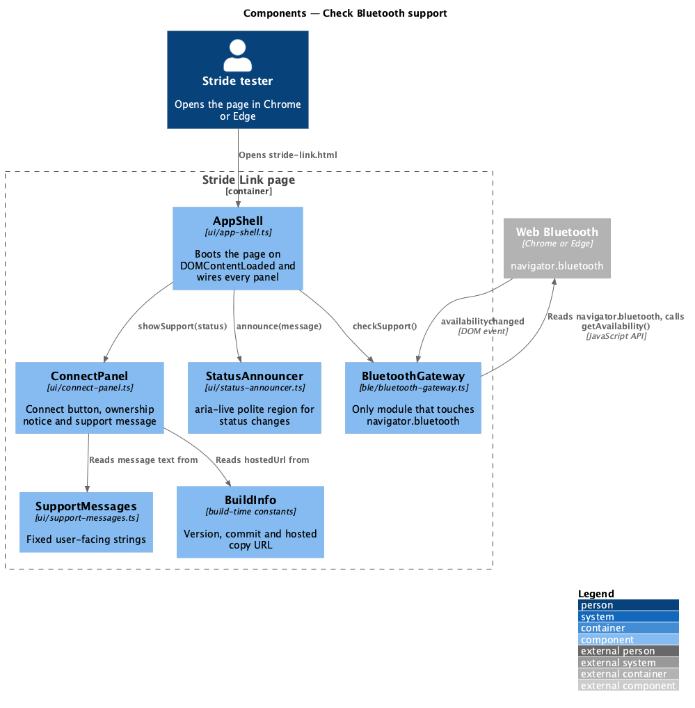
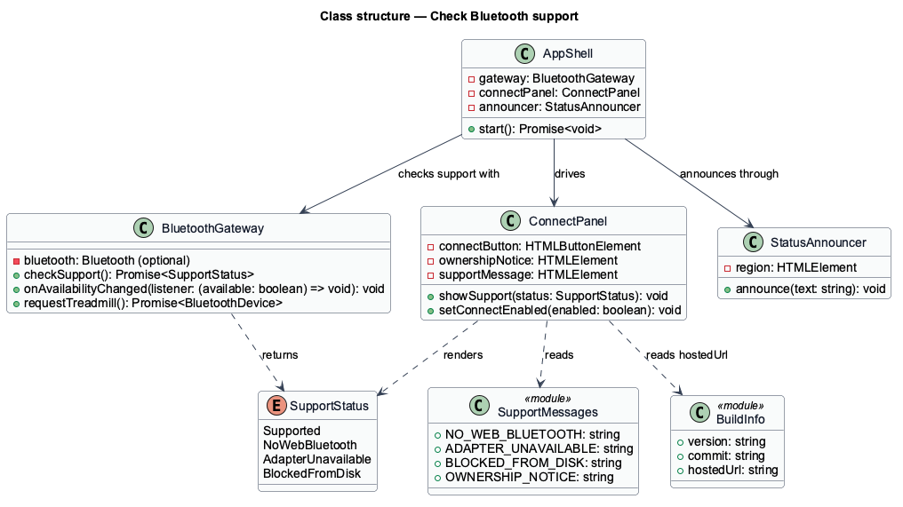
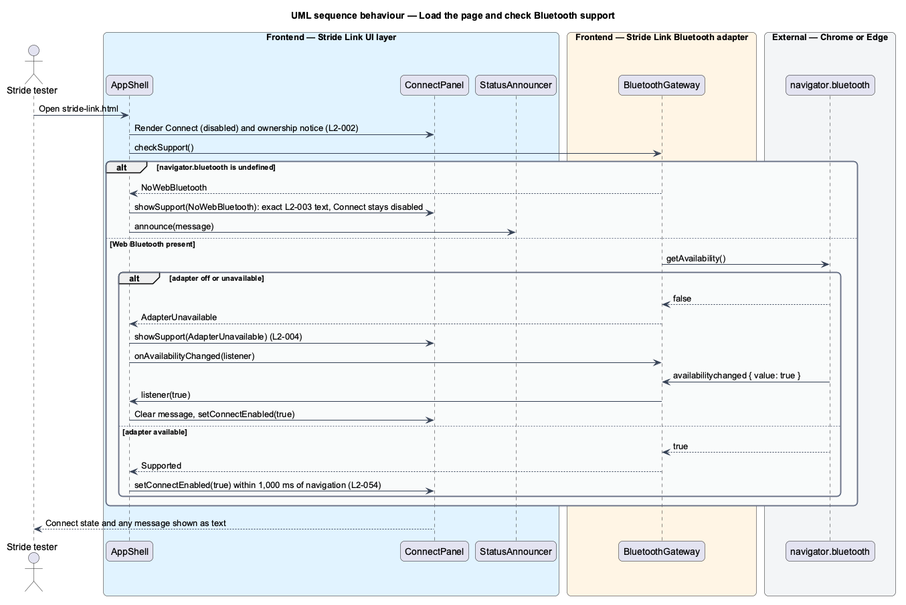
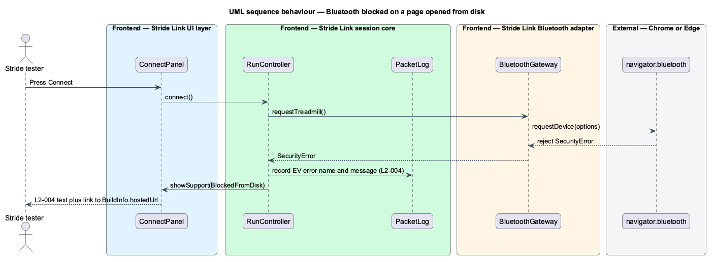

# Check Bluetooth support

## Overview

Stride Link is a single downloadable web page that tests whether a browser can talk to an Echelon Stride treadmill over Web Bluetooth. A tester downloads `stride-link.html`, opens it in Chrome or Edge, and connects to the treadmill.

This feature covers the first moments after the page opens. The page decides whether the browser and the device can use Bluetooth at all. It then either enables **Connect** or explains in plain words why it cannot.

- **Web Bluetooth** — browser API, exposed as `navigator.bluetooth`, through which a page discovers and talks to Bluetooth Low Energy devices
- **support status** — outcome of the check: supported, no Web Bluetooth, adapter unavailable, or blocked from disk
- **hosted copy** — byte-identical copy of `stride-link.html` served over HTTPS, used when a browser blocks Bluetooth on a page opened from disk

The feature sits at the front of the `connection` subsystem. The `select-treadmill` feature takes over once Connect is enabled and pressed.

## Description

- **`AppShell`** — boots the page on `DOMContentLoaded`. It renders the panels, asks `BluetoothGateway` for the support status, and passes the result to `ConnectPanel`. Its start-up work is synchronous apart from one `getAvailability()` call, so Connect is enabled within 1,000 ms (L2-054).
- **`BluetoothGateway`** — the only module that touches `navigator.bluetooth`. `checkSupport()` returns `NoWebBluetooth` when the API is undefined. Otherwise it calls `getAvailability()` and returns `Supported` or `AdapterUnavailable`. `onAvailabilityChanged()` relays the `availabilitychanged` event so Connect can be enabled without a reload.
- **`SupportStatus`** — enumeration of `Supported`, `NoWebBluetooth`, `AdapterUnavailable` and `BlockedFromDisk`.
- **`ConnectPanel`** — owns the Connect button, the ownership notice `Use Stride Link only on a treadmill you own.` and the support message. Connect starts disabled and is enabled only for `Supported`.
- **`SupportMessages`** — fixed strings for each status. The `NoWebBluetooth` text is exactly `This browser can't use Bluetooth. Open this file in Chrome or Edge.`
- **`BuildInfo`** — build-time constants, including `hostedUrl`, the link shown for `BlockedFromDisk`. The hosted URL itself is `<TO SUPPLY>` (PRD open question: where the release lives).
- **`StatusAnnouncer`** — `aria-live="polite"` region that announces the support message.

`BlockedFromDisk` cannot be detected at load time. It appears only when `requestDevice()` rejects with `SecurityError` after Connect is pressed. `RunController` then logs the error and asks `ConnectPanel` to show the hosted-copy message. Whether Chrome allows Web Bluetooth on `file://` pages at all is an open question in the PRD.

Runtime support covers the current and previous stable Chrome and Edge on Windows, macOS, Linux, ChromeOS and Android (L2-005). The page does not sniff the user agent. Any browser exposing `navigator.bluetooth` is treated as supported.

## Requirements

The feature realizes the following level-2 (L2) requirements. Each L2 requirement refines a level-1 (L1) requirement, cited by identifier.

| L2 ID | Refines (L1) | Requirement |
|-------|--------------|-------------|
| `L2-002` | `L1-001` | Given a browser that exposes Web Bluetooth, the page must show an enabled **Connect** button and an ownership notice. |
| `L2-003` | `L1-001` | When Web Bluetooth is missing, the page must say so in plain words and disable Connect. |
| `L2-004` | `L1-001` | The page must explain why Bluetooth can't be used when the adapter is off, or when the browser blocks Bluetooth on a page opened from disk, and must point to the hosted copy. |
| `L2-005` | `L1-001` | Stride Link must support the current and previous stable major versions of Chrome and Edge on Windows, macOS, Linux, ChromeOS and Android. |
| `L2-054` | `L1-012` | The page must become usable quickly on modest hardware. |

## Diagrams

### System context

The tester downloads the page from GitHub Releases and opens it. When Bluetooth is blocked from disk, the page links to the hosted copy.

### Containers

The Stride Link page reads `navigator.bluetooth` from the browser's Web Bluetooth container and listens for its `availabilitychanged` event.

### Components

`AppShell` asks `BluetoothGateway` for the status and hands it to `ConnectPanel`. The panel reads its text from `SupportMessages` and `BuildInfo`.

### Class structure

`AppShell` depends on `BluetoothGateway`, `ConnectPanel` and `StatusAnnouncer`. `SupportStatus` is the value passed between them.

### Behaviour — load the page

The page renders Connect disabled, checks support, and then enables Connect or shows the matching message. An adapter that comes back on re-enables Connect without a reload.

### Behaviour — Bluetooth blocked from disk

A `SecurityError` from `requestDevice()` is logged. It produces the L2-004 message and a link to the hosted copy.

