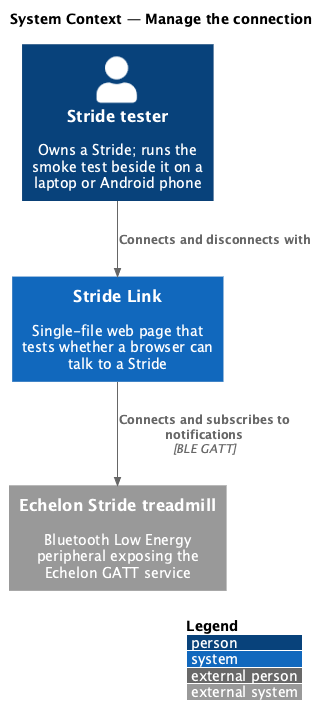
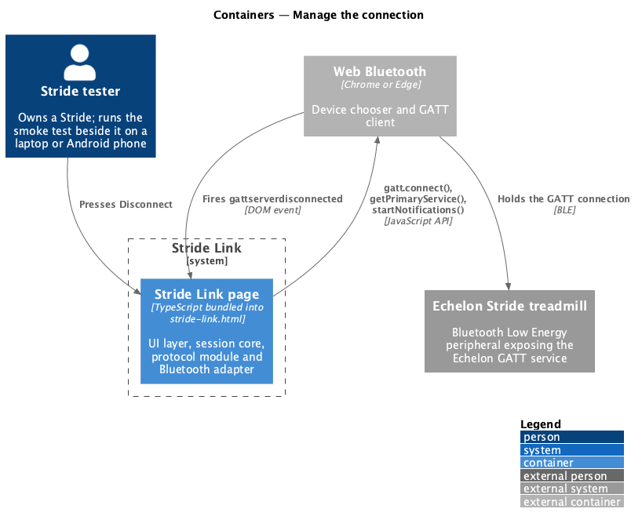
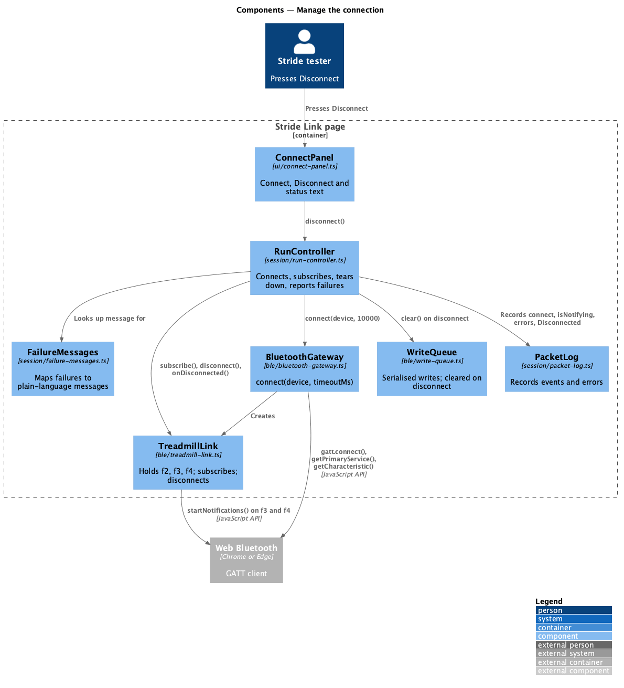
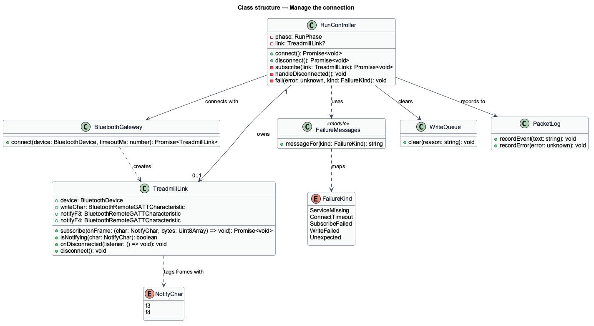
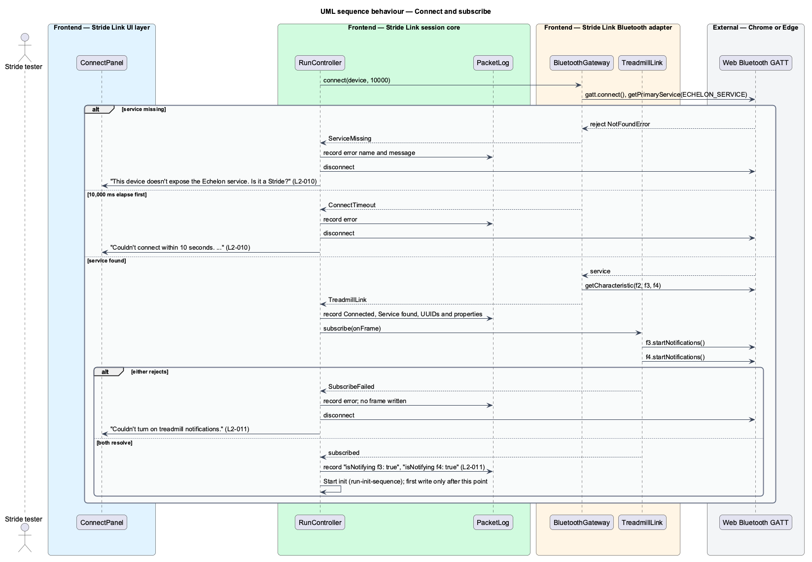
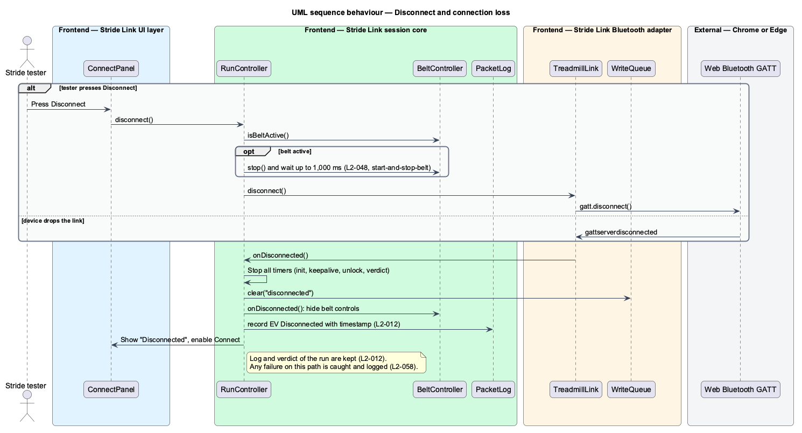

# Manage the connection

## Overview

Once a Stride is selected, Stride Link opens a GATT connection to it. GATT is the Bluetooth Low Energy protocol for reading, writing and subscribing to a device's characteristics. The treadmill exposes one Echelon service with three relevant characteristics.

- **`f2`** — write characteristic (`0bf669f2-45f2-11e7-9598-0800200c9a66`) to which every outbound frame is written
- **`f3`, `f4`** — notify characteristics (`0bf669f3-…`, `0bf669f4-…`) on which the treadmill sends frames
- **subscription** — state in which the browser receives a characteristic's notifications, started with `startNotifications()`

This feature connects, discovers the service, and subscribes to both `f3` and `f4` before anything is written. It also ends the run cleanly, whether the tester presses **Disconnect** or the treadmill drops the link. The `run-init-sequence` feature starts once both subscriptions are on.

The characteristic UUIDs are Observed from qdomyos-zwift `a23bb20`. The PRD abbreviates the service as `0bf669f1-…`, so the full values are to be confirmed on a Stride.

## Description

- **`RunController`** — runs the connect, subscribe and tear-down steps and converts every failure into a message and a log entry. Each asynchronous step sits inside `try`/`catch`. A failure calls `fail(error, kind)`, which logs the error `name` and `message`, disconnects, and re-enables Connect. No `pageerror` or `unhandledrejection` reaches the browser (L2-058).
- **`BluetoothGateway.connect(device, timeoutMs)`** — runs `gatt.connect()`, `getPrimaryService()` and `getCharacteristic()` for `f2`, `f3` and `f4` under one 10,000 ms timeout. It returns a `TreadmillLink`. A missing service gives `ServiceMissing`, and the timeout gives `ConnectTimeout`.
- **`TreadmillLink`** — holds the device and the three characteristics.
  - `subscribe(onFrame)` starts notifications on `f3`, then `f4`, and reports each notification as `(char, bytes)`.
  - `isNotifying(char)` reads the characteristic state after `startNotifications()` resolves. That state is logged as `isNotifying f3: true` and `isNotifying f4: true`.
  - `onDisconnected()` relays `gattserverdisconnected`, and `disconnect()` calls `gatt.disconnect()`.
- **`FailureMessages`** — maps each `FailureKind` to its fixed plain-language message. No message contains a stack trace.
- **`WriteQueue`** — is not used until subscription succeeds, so no frame is written before both subscriptions are on (L2-011). It is cleared on disconnection.
- **`PacketLog`** — receives `Connected`, `Service found`, each characteristic UUID with its properties, the `isNotifying` lines, errors and `Disconnected`.

On disconnection, `RunController` stops every timer (init, keepalive, unlock and verdict), clears the write queue, and hides belt controls. It records `Disconnected` and re-enables Connect. The run's log and verdict are preserved. When the belt is active, a tester-initiated disconnect sends Stop first, as described in the `start-and-stop-belt` feature (L2-048).

## Requirements

The feature realizes the following level-2 (L2) requirements. Each L2 requirement refines a level-1 (L1) requirement, cited by identifier.

| L2 ID | Refines (L1) | Requirement |
|-------|--------------|-------------|
| `L2-010` | `L1-002` | The system must connect, find the Echelon service and its `f2`, `f3` and `f4` characteristics within 10 seconds, and report each failure in plain words. |
| `L2-011` | `L1-002` | Notifications must be started on `f3` and `f4` before the first write, and each must be logged. |
| `L2-012` | `L1-002` | The tester must be able to end a run, and the page must handle an unexpected disconnection cleanly. |
| `L2-058` | `L1-012` | Every asynchronous failure must be caught, shown in plain words and logged. None must escape as an unhandled error. |

## Diagrams

### System context

Stride Link connects to the treadmill and subscribes to its notifications over Bluetooth GATT.

### Containers

The page drives the browser's GATT client. The browser reports connection loss through `gattserverdisconnected`.

### Components

`RunController` connects through `BluetoothGateway`, subscribes and disconnects through `TreadmillLink`, and clears `WriteQueue` on tear-down.

### Class structure

`RunController` owns at most one `TreadmillLink`. Failures are classified by `FailureKind` and worded by `FailureMessages`.

### Behaviour — connect and subscribe

The diagram shows the three failure branches and the success path. Init starts only after both `isNotifying` lines are logged.

### Behaviour — disconnect and connection loss

A tester disconnect and an unexpected drop converge on the same tear-down. The tear-down stops timers, clears the queue, logs, and keeps the verdict.

