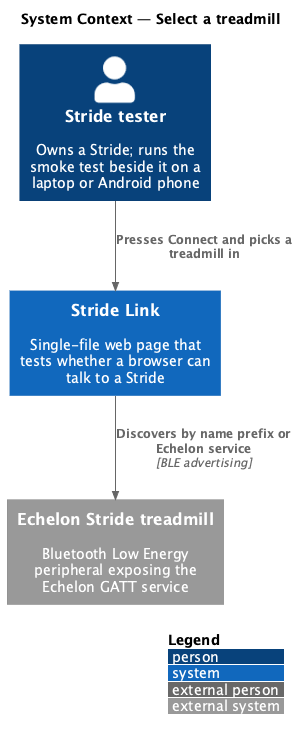
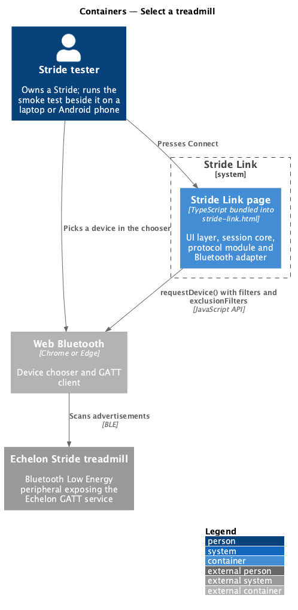
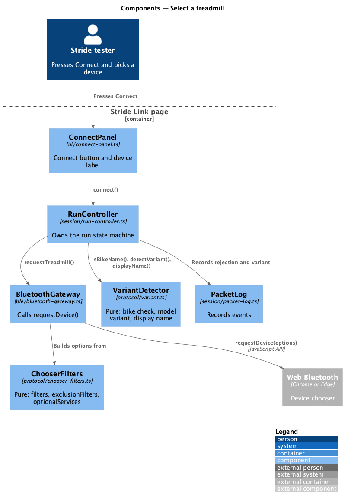
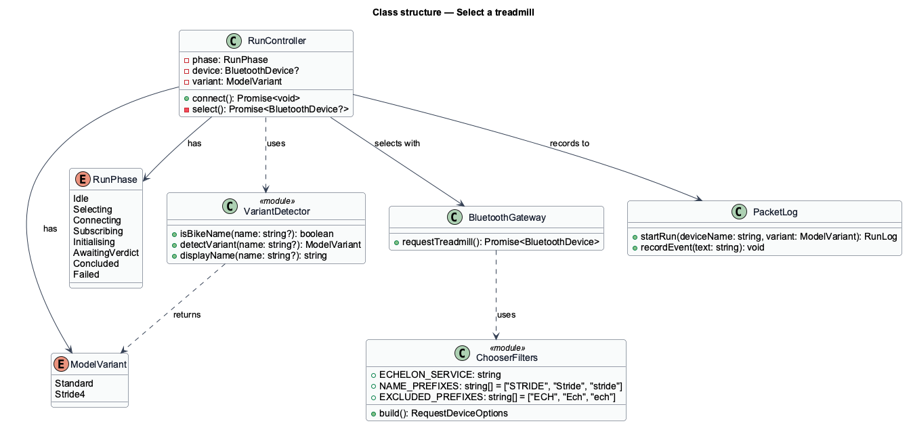
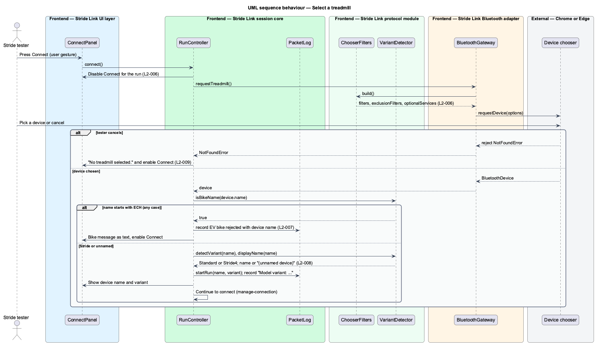

# Select a treadmill

## Overview

Before Stride Link can test a treadmill, the tester picks it from the browser's Bluetooth chooser. The chooser is a browser-owned dialog that lists nearby devices matching the page's filters. A page can open it only in response to a user gesture.

This feature covers pressing **Connect**, filtering the chooser to Echelon Stride treadmills, and rejecting Echelon bikes. It also detects which protocol variant the chosen treadmill speaks.

- **name prefix filter** — chooser filter that matches devices whose advertised name begins with a given string; the match is case-sensitive
- **exclusion filter** — chooser filter that removes matching devices from the list
- **model variant** — protocol dialect of a Stride: `Stride4` when the name starts with `STRIDE4` in any case, otherwise `Standard`
- **run** — one connection to one treadmill, from pressing Connect to disconnection

The feature sits between `check-bluetooth-support`, which enables Connect, and `manage-connection`, which opens the GATT connection.

## Description

- **`ConnectPanel`** — forwards the Connect press to `RunController` and shows the chosen device name and variant. Connect stays disabled until the run ends (L2-006).
- **`RunController`** — owns the run state machine (`RunPhase`: `Idle`, `Selecting`, `Connecting`, `Subscribing`, `Initialising`, `AwaitingVerdict`, `Concluded`, `Failed`). `connect()` moves to `Selecting` and calls `BluetoothGateway.requestTreadmill()` inside the click handler, so the user-gesture rule holds. Nothing calls `requestDevice()` or `getDevices()` before a Connect press, so the page does not reconnect on its own.
- **`ChooserFilters`** — pure module that builds the `requestDevice()` options:
  - `filters`: `{namePrefix: "STRIDE"}`, `{namePrefix: "Stride"}`, `{namePrefix: "stride"}`, and `{services: ["0bf669f1-45f2-11e7-9598-0800200c9a66"]}`.
  - `exclusionFilters`: `{namePrefix: "ECH"}`, `{namePrefix: "Ech"}`, `{namePrefix: "ech"}`.
  - `optionalServices`: the Echelon service UUID.

  Name prefixes are case-sensitive. The three casings cover common names, and the service filter catches the rest.
- **`VariantDetector`** — pure module.
  - `isBikeName(name)` is true when the name starts with `ech` in any case. It backs up the exclusion filters, because a bike that advertises the Echelon service still reaches the page through the service filter in browsers without `exclusionFilters` support.
  - `detectVariant(name)` returns `Stride4` for names starting `stride4` in any case.
  - `displayName(name)` returns `(unnamed device)` for a missing name.
- **`BluetoothGateway`** — calls `navigator.bluetooth.requestDevice(options)` and returns the device or the rejection.
- **`PacketLog`** — `startRun()` opens a new run section once a Stride is accepted. Rejections and `Model variant: ...` are recorded as events.

A chooser cancellation (`NotFoundError`) returns the page to idle with `No treadmill selected.`. It creates no run and no verdict (L2-009).

## Requirements

The feature realizes the following level-2 (L2) requirements. Each L2 requirement refines a level-1 (L1) requirement, cited by identifier.

| L2 ID | Refines (L1) | Requirement |
|-------|--------------|-------------|
| `L2-006` | `L1-002` | Pressing Connect must open the browser chooser filtered to Strides by name prefix or Echelon service, with names starting `ECH` excluded. The chooser must open only from a Connect press. |
| `L2-007` | `L1-002` | A device whose name starts with `ECH` in any case must be rejected even if it reaches the page. |
| `L2-008` | `L1-002` | The system must choose the Stride 4 variant when the device name starts with `STRIDE4` in any case, and the standard variant otherwise. |
| `L2-009` | `L1-002` | Cancelling the chooser must return the page to idle without an error state. |

## Diagrams

### System context

The tester picks a treadmill through Stride Link. Stride Link discovers Strides from their Bluetooth advertisements.

### Containers

The page calls `requestDevice()` on the Web Bluetooth container. The tester picks the device in the browser-owned chooser.

### Components

`RunController` asks `BluetoothGateway` for a device using options from `ChooserFilters`. It then classifies the result with `VariantDetector`.

### Class structure

`RunController` holds the `RunPhase` and the `ModelVariant`. It uses the two pure modules and records to `PacketLog`.

### Behaviour — select a treadmill

The diagram covers three outcomes: a cancelled chooser, a rejected bike, and an accepted Stride whose variant is detected and logged.

