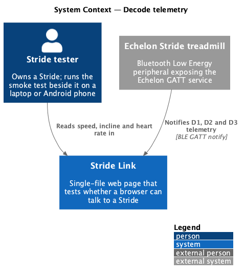
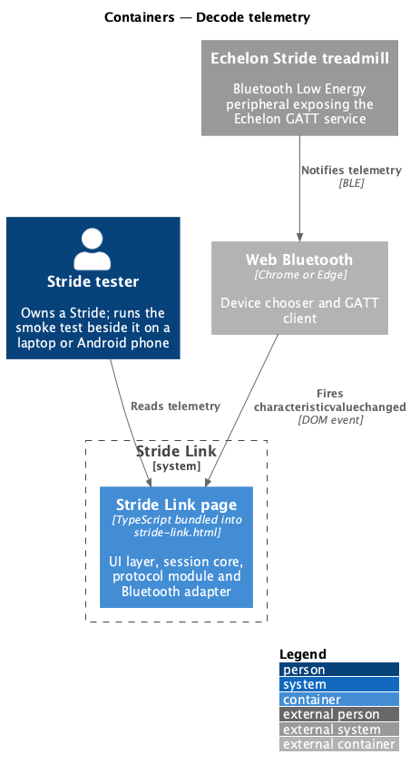
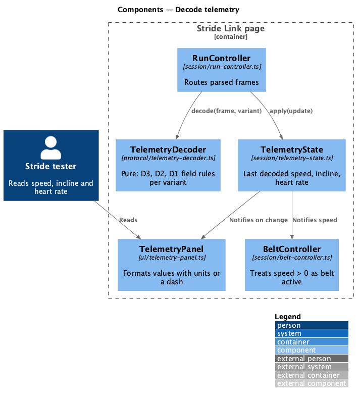
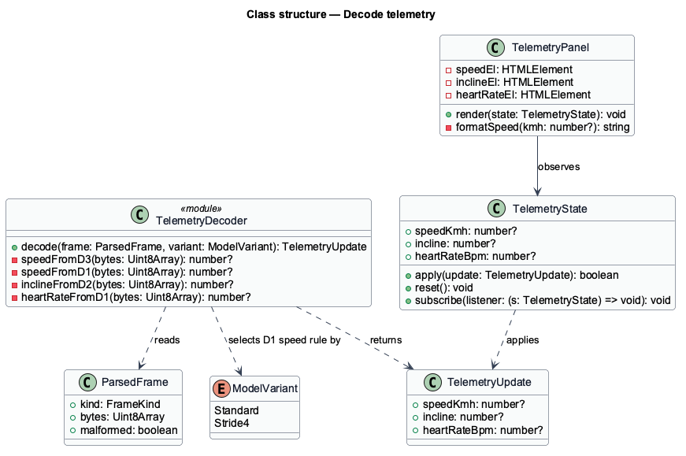
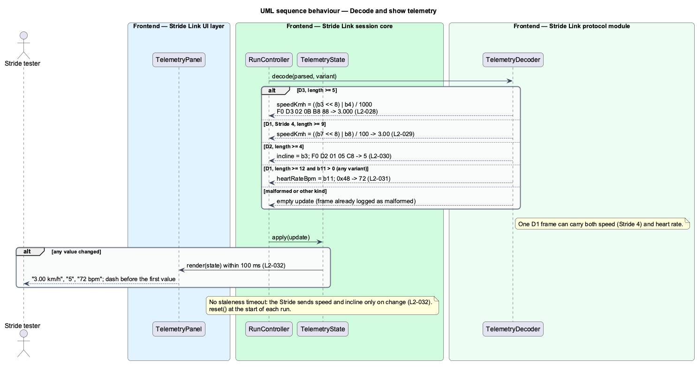

# Decode telemetry

## Overview

Once a Stride talks, it reports speed, incline and, on some models, heart rate. Each arrives in its own frame type. The treadmill sends speed and incline only when they change, so a quiet but connected treadmill is normal once it has talked.

- **`D3` frame** — `F0 D3 02 hi lo ck`; speed in km/h equals (hi x 256 + lo) / 1000
- **`D2` frame** — `F0 D2 01 n ck`; incline equals `n`
- **`D1` frame** — Stride 4 frame of 12 or more bytes; speed in km/h equals ((byte 7 << 8) | byte 8) / 100, and heart rate in bpm equals byte 11 when it is above 0
- **telemetry state** — last decoded speed, incline and heart rate of the current run

This feature decodes those frames and shows the values. Echoing `D2` and `D3` back is handled by `keep-link-alive`.

## Description

- **`TelemetryDecoder`** — pure module. `decode(frame, variant)` returns a `TelemetryUpdate` with any of `speedKmh`, `incline` and `heartRateBpm`:
  - `D3` with at least 5 bytes gives speed. `F0 D3 02 0B B8 88` gives 3.000.
  - `D1` with the `Stride4` variant and at least 9 bytes gives speed. The standard variant ignores `D1` speed.
  - `D2` with at least 4 bytes gives incline. `F0 D2 01 05 C8` gives 5.
  - `D1` with at least 12 bytes and byte 11 above 0 gives heart rate, for both variants. `0x48` gives 72.

  One `D1` frame can carry both speed and heart rate. Frames marked `malformed` by `FrameParser` give an empty update, because they were already logged.
- **`TelemetryState`** — `apply(update)` stores the present fields and reports whether anything changed. `reset()` clears all three values at the start of each run. Values are never cleared for staleness (L2-032). Listeners are `TelemetryPanel` and `BeltController`, which treats a speed above 0 as an active belt.
- **`TelemetryPanel`** — renders speed with two decimals and `km/h` (`3.00 km/h`), incline as a whole number (`5`), and heart rate with `bpm` (`72 bpm`). Each shows `—` before its first value. Updates land within 100 ms of receipt. They are not announced to screen readers, to avoid flooding the live region (L2-063).

## Requirements

The feature realizes the following level-2 (L2) requirements. Each L2 requirement refines a level-1 (L1) requirement, cited by identifier.

| L2 ID | Refines (L1) | Requirement |
|-------|--------------|-------------|
| `L2-028` | `L1-007` | For a `D3` frame of at least 5 bytes, speed in km/h must equal ((byte 3 << 8) \| byte 4) / 1000. |
| `L2-029` | `L1-007` | For the Stride 4 variant only, a `D1` frame of at least 9 bytes must set speed in km/h to ((byte 7 << 8) \| byte 8) / 100. |
| `L2-030` | `L1-007` | For a `D2` frame of at least 4 bytes, incline must equal byte 3. |
| `L2-031` | `L1-007` | For a `D1` frame of 12 bytes or more whose byte 11 is above 0, heart rate in bpm must equal byte 11. This applies to both variants. |
| `L2-032` | `L1-007` | Speed, incline and heart rate must each show the last decoded value with its unit, or a dash before the first value. Values must not be cleared for staleness, because the treadmill sends speed and incline only when they change. |

## Diagrams

### System context

The treadmill notifies telemetry, and the tester reads the decoded values in Stride Link.

### Containers

Telemetry notifications reach the page through Web Bluetooth `characteristicvaluechanged` events.

### Components

`RunController` passes parsed frames to `TelemetryDecoder` and applies the result to `TelemetryState`. That state feeds `TelemetryPanel` and `BeltController`.

### Class structure

`TelemetryDecoder` reads a `ParsedFrame` and a `ModelVariant` and returns a `TelemetryUpdate`, which `TelemetryState` applies.

### Behaviour — decode and show telemetry

Each frame kind has its own rule and minimum length. A change in state re-renders the panel within 100 ms.

