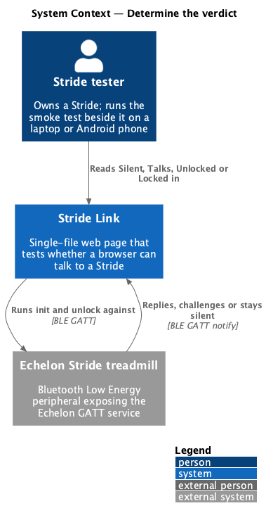
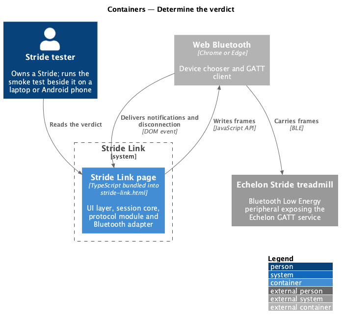
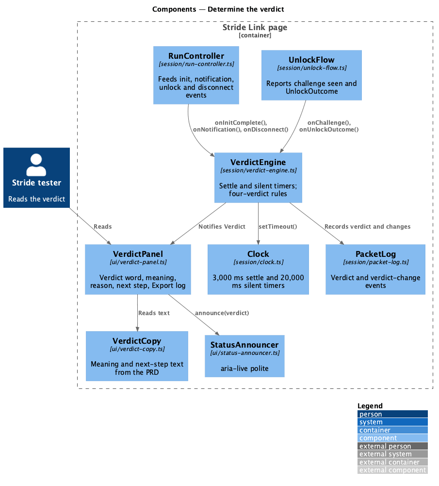
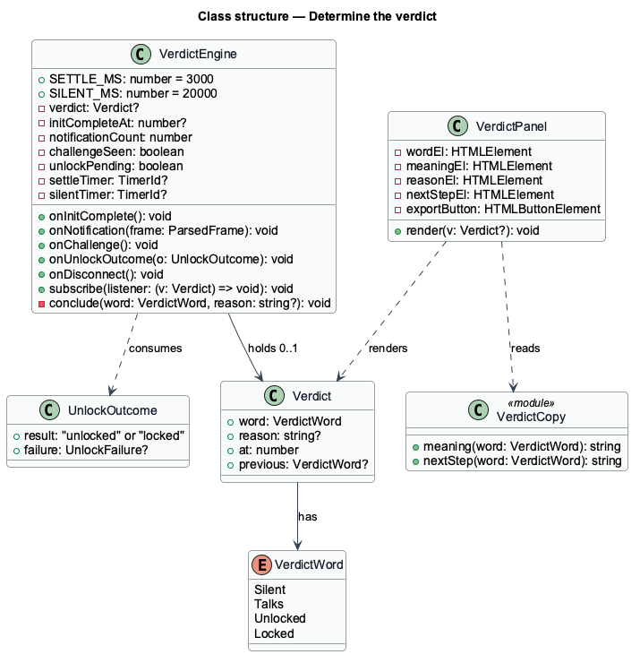
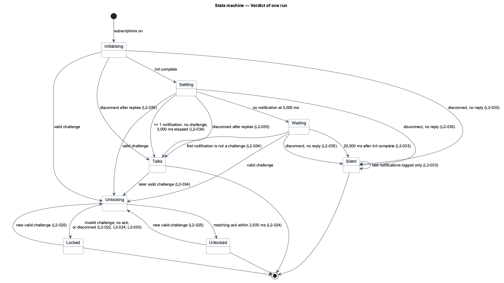
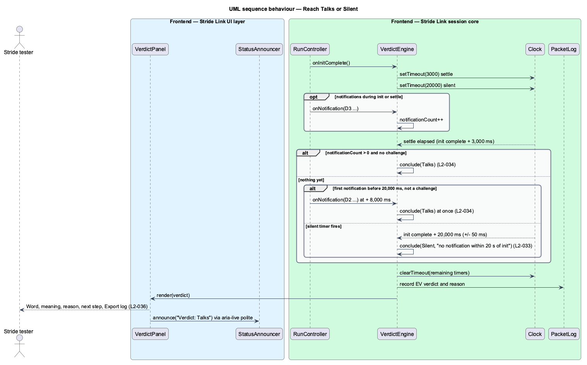
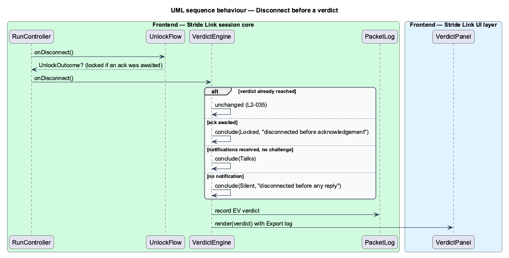

# Determine the verdict

## Overview

Stride Link exists to answer one question per treadmill: can a browser talk to it? The answer is a verdict.

- **verdict** — outcome of a run; exactly one of **Silent**, **Talks**, **Unlocked** or **Locked**
- **Silent** — verdict for a treadmill that sends no notification within 20 s of init complete
- **Talks** — verdict for a treadmill that sends notifications without an unlock challenge
- **Unlocked** — verdict for a treadmill whose challenge was answered and acknowledged
- **Locked** — verdict for a treadmill whose challenge was invalid or not acknowledged within 2.5 s
- **settle window** — 3,000 ms after init complete during which a challenge can still arrive before **Talks** is declared

The settle window is a design decision recorded in L2-034. Without it, a locked treadmill that replies to init before it challenges would briefly show **Talks**, and with it the belt-control gate.

## Description

- **`VerdictEngine`** — holds the run's verdict and decides it from five inputs:
  - **`onInitComplete()`** — starts the settle timer (3,000 ms) and the silent timer (20,000 ms) on `Clock`.
  - **`onNotification(frame)`** — counts notifications. After the settle window, a first notification that is not a challenge concludes **Talks** at once.
  - **`onChallenge()`** — marks a challenge seen and an unlock pending, and cancels any pending **Talks**.
  - **`onUnlockOutcome(o)`** — concludes **Unlocked** or **Locked** with the outcome's reason.
  - **`onDisconnect()`** — before a verdict, concludes **Locked** if an acknowledgement was awaited, **Talks** if notifications arrived, and otherwise **Silent** with `disconnected before any reply`.
- **Rules after a verdict** —
  - **Silent** is final for the run. Late notifications are logged and echoed but change nothing (L2-033).
  - **Talks**, **Unlocked** and **Locked** can be replaced by a later unlock attempt. Each change is logged as `Verdict changed: <old> -> <new>` (L2-025, L2-034).
- **`Verdict`** — `word`, optional `reason`, time `at`, and the `previous` word for change logging.
- **`VerdictCopy`** — PRD wording for each verdict's meaning and next step:

  | Verdict | Meaning | Next step |
  |---------|---------|-----------|
  | Silent | No notification within 20 s of init | Export the log; capture the official app for comparison |
  | Talks | Notifications arrive and no challenge was sent | Read telemetry; belt commands can be tried |
  | Unlocked | Challenge answered and acknowledged | Read telemetry; belt commands can be tried |
  | Locked | Challenge invalid or not acknowledged in 2.5 s | Export the log with the challenge bytes |

- **`VerdictPanel`** — renders the word as heading text, then the meaning, the reason (for **Silent** and **Locked**) and the next step. An **Export log** button is always present with a verdict. Colour supplements the word and never replaces it (L2-062).
- **`StatusAnnouncer`** — announces each verdict and each change through `aria-live="polite"`.
- **Errors before init** — failures such as a missing service or a connect timeout produce no verdict. The export records `Verdict: none` for that run.

## Requirements

The feature realizes the following level-2 (L2) requirements. Each L2 requirement refines a level-1 (L1) requirement, cited by identifier.

| L2 ID | Refines (L1) | Requirement |
|-------|--------------|-------------|
| `L2-033` | `L1-008` | If no notification of any kind is received within 20,000 ms after init complete, the verdict must be **Silent**. Silent is final for the run. |
| `L2-034` | `L1-008` | The verdict must be **Talks** when at least one notification has been received, none was an `E0` challenge, and 3,000 ms have passed since init complete. If the first notification arrives later than 3,000 ms but within 20,000 ms of init complete and is not a challenge, the verdict must be **Talks** at once. A later valid challenge must start the unlock flow and replace the verdict. |
| `L2-035` | `L1-008` | A disconnection after init has started but before a verdict must still produce one of the four verdicts. |
| `L2-036` | `L1-008` | The verdict must be shown as a word, with its meaning, its reason where one exists, and its next step, using the PRD's wording. Export log must be offered with every verdict. |

## Diagrams

### System context

Stride Link runs init and unlock against the treadmill. The treadmill's replies, challenge or silence decide the verdict the tester reads.

### Containers

Notifications and disconnection events reach the page through Web Bluetooth. The verdict is shown on the page.

### Components

`RunController` and `UnlockFlow` feed `VerdictEngine`, which times with `Clock`. `VerdictPanel` renders the verdict with text from `VerdictCopy` and announces it.

### Class structure

`VerdictEngine` holds at most one `Verdict` and consumes `UnlockOutcome`. `VerdictPanel` renders the verdict using `VerdictCopy`.

### Verdict state machine

The state machine shows every path to the four verdicts: settle and silent timing, unlock attempts, repeated challenges, and disconnection.

### Behaviour — reach Talks or Silent

The settle timer decides **Talks** when replies arrived without a challenge. Otherwise the first non-challenge reply decides **Talks**, or the silent timer decides **Silent**.

### Behaviour — disconnect before a verdict

A disconnection before a verdict still yields one of the four verdicts, chosen by what has been seen so far.

