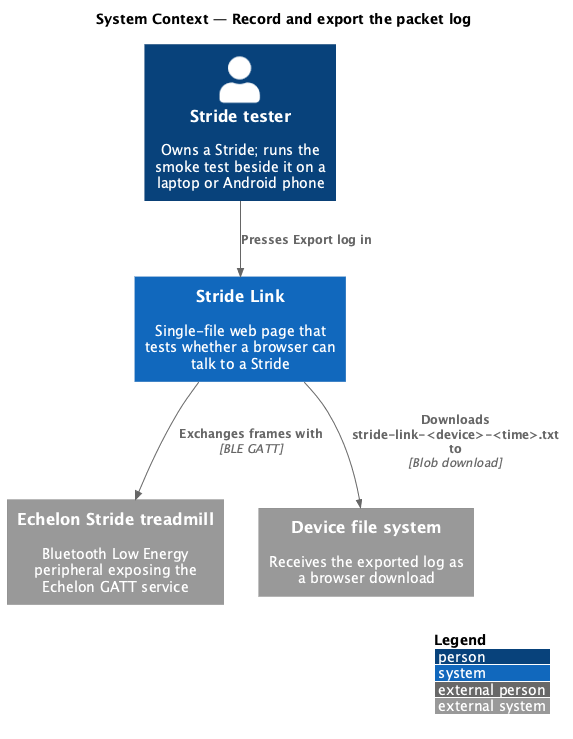
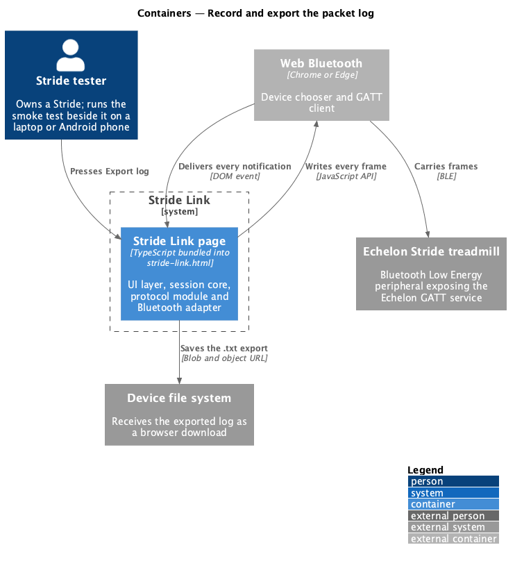
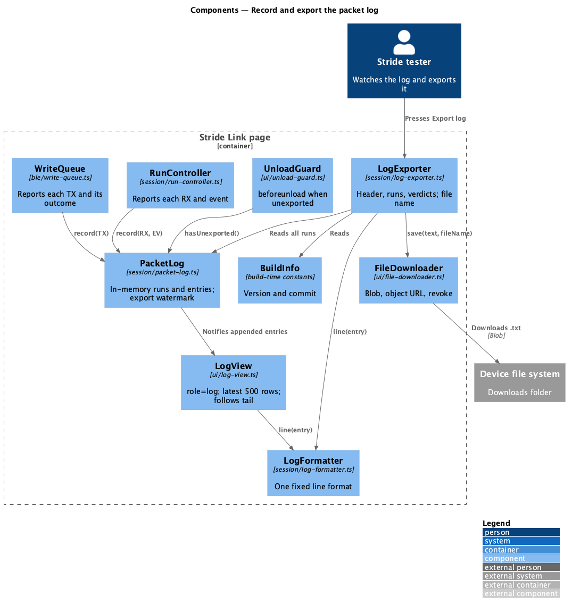
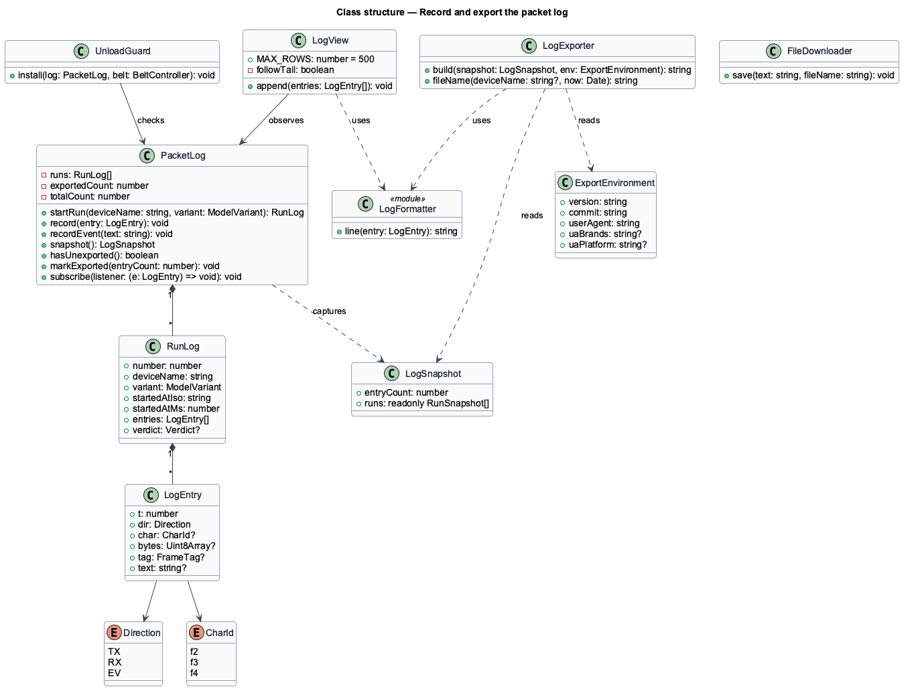
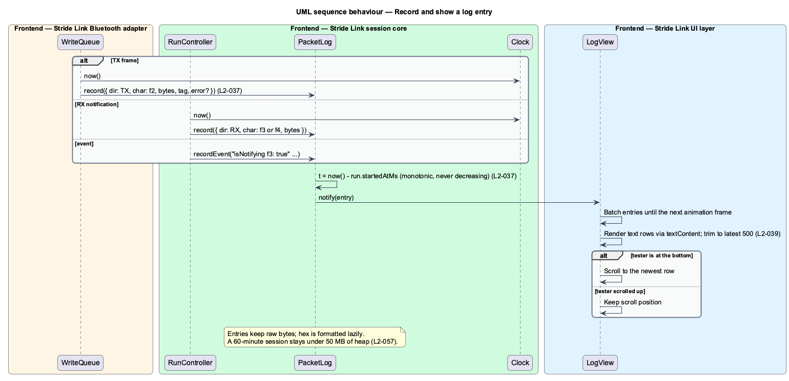
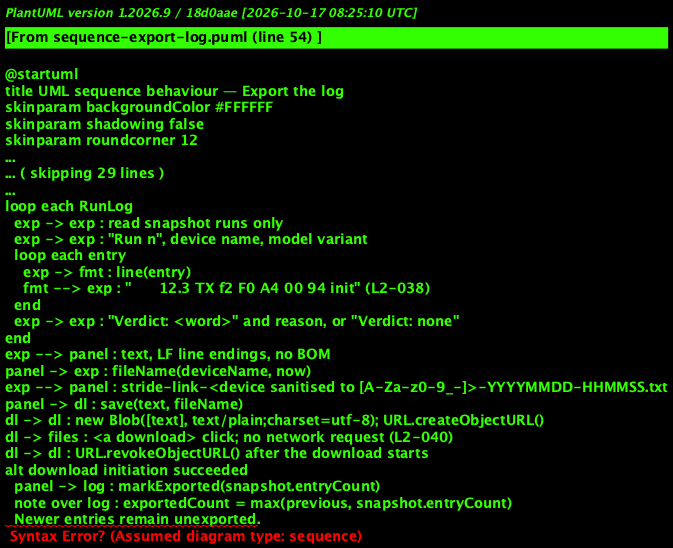

# Record and export the packet log

## Overview

A verdict alone is not enough. When a treadmill stays silent, the next step is to compare what Stride Link sent with a capture of the official app pairing, such as an Android HCI snoop log. The packet log makes that comparison possible.

- **packet log** — ordered, in-memory record of every frame sent and received and every protocol event in a page session
- **entry** — one line of the log: `TX` (written to `f2`), `RX` (notified on `f3` or `f4`) or `EV` (event)
- **run section** — part of the log belonging to one run, headed `Run <n>`
- **export** — UTF-8 plain-text file of the whole log, generated locally and downloaded by the browser

Success, as the PRD defines it, includes every verdict coming with an export that is enough to reproduce it. Nothing leaves the device unless the tester presses **Export log**.

## Description

- **`PacketLog`** — holds `RunLog` sections.
  - `startRun(deviceName, variant)` opens a section with its start time in ISO 8601 and on the monotonic clock.
  - `record(entry)` appends a `TX` or `RX` entry. `WriteQueue` records every TX after its write settles, with the error when it failed. `RunController` records every RX before parsing.
  - `recordEvent(text)` appends `EV` entries: connect, subscription state, model variant, init complete, unlock values, verdict and its changes, errors, and disconnect.
  - Entry time `t` is `Clock.now()` minus the run start, so it never decreases within a run.
  - Sections accumulate across runs and are never cleared during a page session (L2-041).
- **`LogEntry`** — `t`, `dir`, `char` (`f2`, `f3` or `f4`), raw `bytes`, `tag` and `text`. Hex is formatted only when shown or exported. Raw bytes use less memory, which keeps a 60-minute session (about 146,000 entries) under 50 MB of heap (L2-057).
- **`LogFormatter`** — one fixed line format: milliseconds with one decimal, right-aligned to 10 characters, then the direction, the characteristic, the hex and the tag.

  ```
        12.3 TX f2 F0 A4 00 94 init
       318.0 RX f4 F0 A4 00 94
       318.4 EV isNotifying f3: true
  ```
- **`LogView`** — the on-screen log, with `role="log"` and the accessible name `Packet log`.
  - It batches new entries until the next animation frame and renders them as text nodes.
  - It keeps only the latest 500 rows in the DOM.
  - It follows new entries while the tester is at the bottom, and keeps the scroll position otherwise.
- **`LogExporter`** — `build(snapshot, env)` writes a header, then each run section, then each run's verdict line:
  - The header holds the Stride Link version and commit, `navigator.userAgent`, the `navigator.userAgentData` brands and platform where available, and the start time.
  - Each run section holds `Run <n>`, the device name, the model variant and every entry.
  - The closing line is `Verdict: <word>` with its reason, or `Verdict: none`.

  Lines end with LF, and the file has no byte-order mark. `fileName()` gives `stride-link-<device>-<YYYYMMDD-HHMMSS>.txt`, with every character of the device name outside `[A-Za-z0-9_-]` replaced by `_`, or `unknown`.
- **`FileDownloader`** — creates a `Blob` of type `text/plain;charset=utf-8` and an object URL, and clicks a temporary `<a download>`. It revokes the URL after the download starts. No network request is made.
- **`UnloadGuard`** — triggers the browser's `beforeunload` confirmation only while `PacketLog.hasUnexported()` is true. The log is not persisted, so closing the tab discards it.
- **Export snapshot** — `PacketLog.snapshot()` captures the entry count, run metadata, verdicts and each run's entry boundary synchronously. The formatter reads only that snapshot. Immutable stored entries can be shared without copying their byte arrays. `markExported(snapshot.entryCount)` advances the exported count with `max(previous, snapshot.entryCount)` only after download initiation succeeds. Newer entries remain unexported, including when two exports complete in reverse order (L2-040, L2-041).
- **Download failure** — Blob creation, URL creation and click errors propagate to the UI error boundary, which records their name and message and shows a plain-language failure. Failed initiation does not advance the exported count. The downloader removes its temporary anchor and revokes any allocated URL on failure; successful initiation schedules URL revocation after the click. Browser download initiation is the observable boundary, since the page cannot confirm that the user saved the file (L2-058).
- **Entry ownership** — `PacketLog.record()` copies exactly the supplied byte range into log-owned storage before returning. Callers cannot mutate recorded bytes through a reused notification buffer. Readers receive immutable entry views; snapshots expose bounded iteration rather than mutable `RunLog` arrays (L2-037, L2-040).
- **Export availability** — Export log is available whenever the log has at least one entry, including after a failure before any verdict.

## Requirements

The feature realizes the following level-2 (L2) requirements. Each L2 requirement refines a level-1 (L1) requirement, cited by identifier.

| L2 ID | Refines (L1) | Requirement |
|-------|--------------|-------------|
| `L2-037` | `L1-009` | Every frame written or received, and every protocol event, must be recorded in order with a monotonic timestamp. |
| `L2-038` | `L1-009` | Each log line must use one fixed, diff-friendly format: `<ms> <DIR> <char> <hex> <tag>`. `<ms>` is milliseconds since the run started, with one decimal place, right-aligned to 10 characters. |
| `L2-039` | `L1-009` | The page must show the log live, with the most recent 500 entries in the DOM, while the full log is kept in memory for export. |
| `L2-040` | `L1-009` | Pressing **Export log** must download a UTF-8 `.txt` file, generated locally, containing a header, every entry of every run on the page, and each run's verdict. |
| `L2-041` | `L1-009` | Logs must accumulate across runs within one page session, live only in memory, and the tester must be warned before closing the page with unexported entries. |
| `L2-057` | `L1-012` | The page must stay responsive and bounded in memory for a one-hour session. |

## Diagrams

### System context

Stride Link records its exchange with the treadmill and, on request, downloads the log to the device's file system.



### Containers

Every frame through Web Bluetooth is recorded in the page. The export is saved through a Blob download.



### Components

`WriteQueue` and `RunController` record into `PacketLog`, which `LogView` displays. `LogExporter` formats the log and passes it to `FileDownloader`.



### Class structure

`PacketLog` composes `RunLog` sections, which compose `LogEntry` items. `LogFormatter` is shared by the view and the exporter.



### Behaviour — record and show an entry

TX, RX and event entries are timestamped on the monotonic clock. They are rendered in batches and trimmed to 500 rows.



### Behaviour — export the log

The exporter builds the header, every run and every verdict line. The text is downloaded locally, and the log is marked exported.


