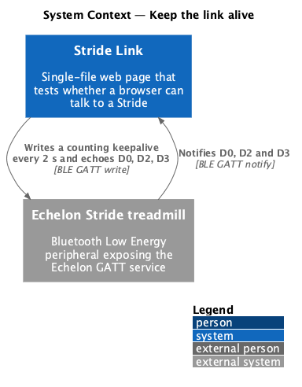
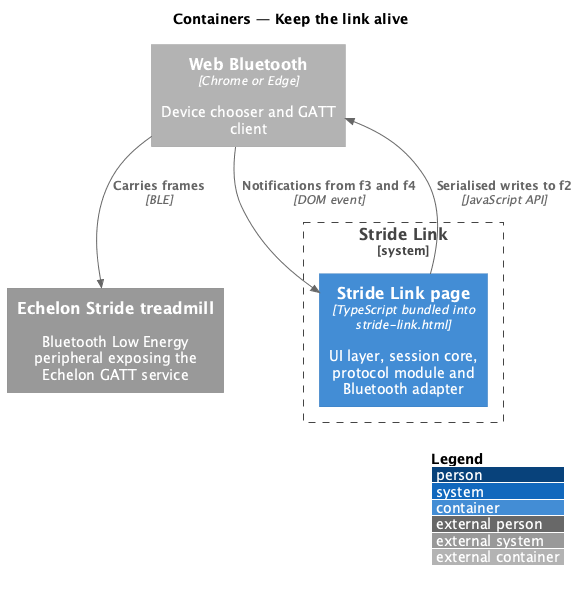
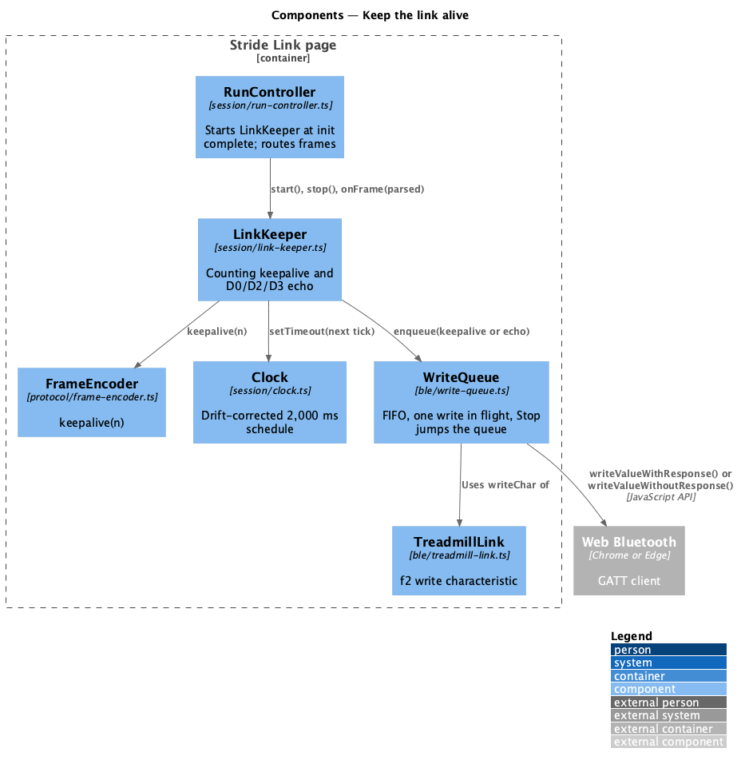
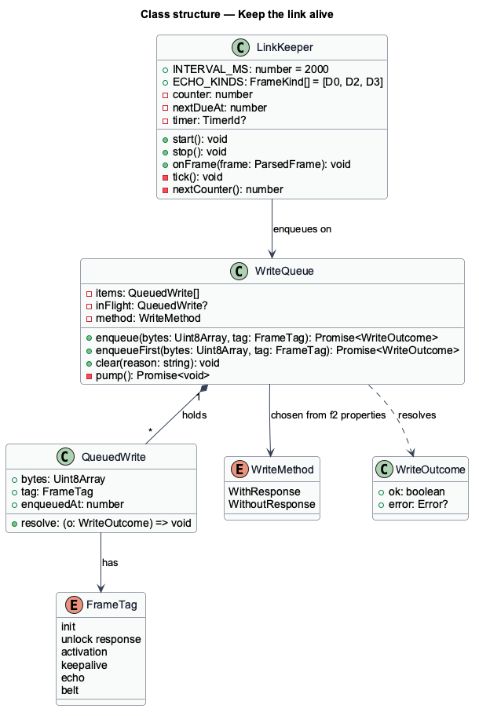
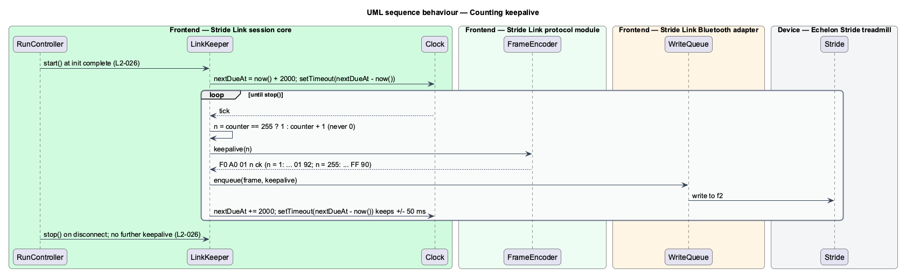
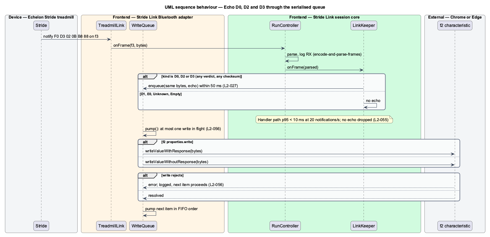

# Keep the link alive

## Overview

A Stride expects two kinds of traffic from a connected client. Wattzup sent neither correctly. It sent a fixed keepalive every second and never echoed anything.

- **keepalive** — frame `F0 A0 01 n ck` written every 2,000 ms, where the counter `n` runs from 1 to 255 and wraps to 1
- **echo** — byte-for-byte copy of an inbound `D0`, `D2` or `D3` frame, written back to `f2`
- **write queue** — single first-in, first-out list through which every write to `f2` passes, with at most one GATT write in flight

This feature keeps the link alive from init complete until disconnection. It also owns the write queue that serialises all writes, because Web Bluetooth rejects overlapping GATT operations on one characteristic.

## Description

- **`LinkKeeper`** — `start()` is called at init complete.
  - It schedules ticks against a target time (`nextDueAt += 2000`) rather than a free-running interval, so drift stays within +/- 50 ms.
  - Each tick computes `n`: 1 after 255, otherwise `counter + 1`, never 0. It enqueues `FrameEncoder.keepalive(n)` tagged `keepalive`.
  - `stop()` cancels the timer on disconnection.
  - `onFrame(parsed)` enqueues an echo, tagged `echo`, for every frame of kind `D0`, `D2` or `D3`, under every verdict and whatever the checksum. `D1`, `E0`, `Unknown` and `Empty` frames are not echoed.
- **`WriteQueue`** —
  - `enqueue(bytes, tag)` appends a `QueuedWrite` and returns a promise of `WriteOutcome`.
  - `enqueueFirst(bytes, tag)` inserts at the head, ahead of every waiting item but not the one in flight. Only the belt Stop command uses it.
  - `pump()` writes one item at a time and starts the next only after the current write settles. A rejected write resolves `ok: false`, is logged, and does not block the queue.
  - `clear(reason)` resolves all waiting items as cancelled on disconnection.
  - The write method follows the `f2` properties: `writeValueWithResponse` when `properties.write` is true, otherwise `writeValueWithoutResponse`. The choice is logged once per run.
- **`FrameTag`** — `init`, `unlock response`, `activation`, `keepalive`, `echo` and `belt`. Every TX log entry carries one.
- **Latency** — the notification handler runs synchronously from receipt to echo enqueued and log entry recorded. Its 95th percentile stays under 10 ms at 20 notifications per second, and no echo is dropped (L2-055). DOM updates for the log are batched separately and do not sit on this path.

## Requirements

The feature realizes the following level-2 (L2) requirements. Each L2 requirement refines a level-1 (L1) requirement, cited by identifier.

| L2 ID | Refines (L1) | Requirement |
|-------|--------------|-------------|
| `L2-026` | `L1-006` | From init complete until disconnection, the system must write `F0 A0 01 n ck` every 2,000 ms. `n` starts at 1, counts to 255 and wraps to 1. |
| `L2-027` | `L1-006` | Every inbound `D0`, `D2` and `D3` frame, from either notify characteristic, must be written back to `f2` byte-for-byte. This applies under every verdict and whether or not the checksum is valid. |
| `L2-055` | `L1-012` | Each notification must be logged, decoded and, where required, echoed promptly. |
| `L2-056` | `L1-012` | Every write to `f2` must go through one FIFO queue with at most one GATT write in flight. Stop is the only frame allowed to jump the queue. |

## Diagrams

### System context

Stride Link writes a counting keepalive and echoes `D0`, `D2` and `D3` frames back to the treadmill.

### Containers

All writes reach the Web Bluetooth container serialised. This view and the context view carry the same facts for this slice. The component view holds the detail.

### Components

`RunController` routes parsed frames to `LinkKeeper`, which enqueues keepalives and echoes on `WriteQueue`.

### Class structure

`WriteQueue` composes `QueuedWrite` items, each with a `FrameTag`. It chooses its `WriteMethod` from the `f2` properties.

### Behaviour — counting keepalive

The keepalive starts at init complete, wraps from 255 to 1, and stops on disconnection.

### Behaviour — echo through the serialised queue

A `D3` notification is echoed unchanged. The queue writes one item at a time and continues after a failure.

