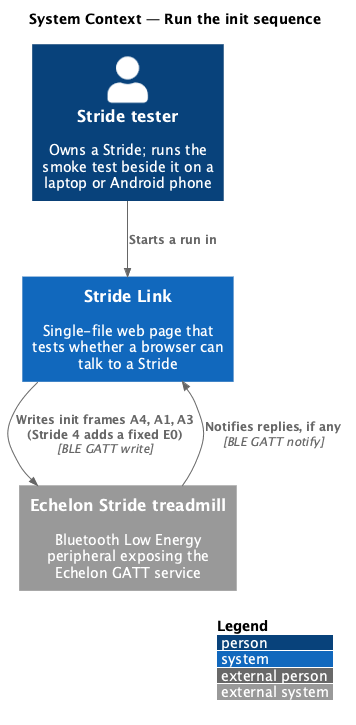
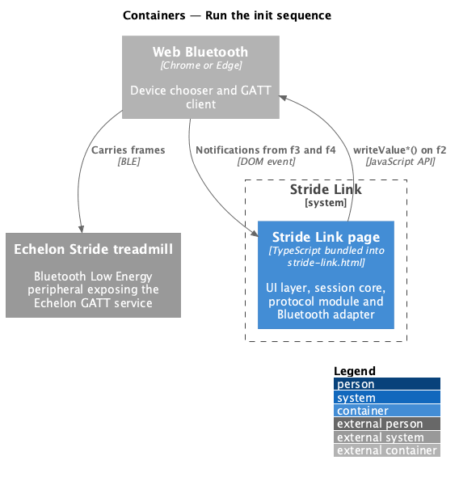
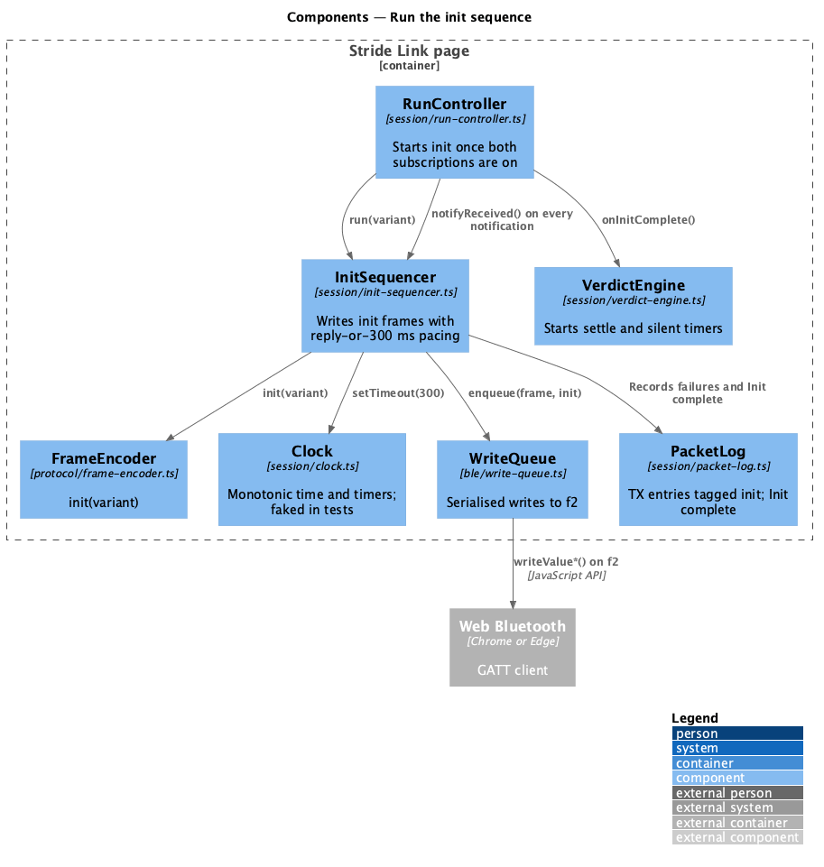
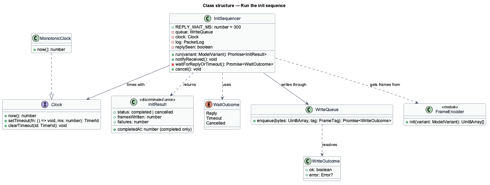
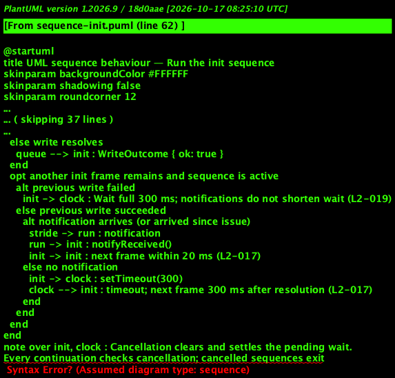

# Run the init sequence

## Overview

After subscribing, Stride Link writes a fixed series of frames that qdomyos-zwift sends to wake a Stride and request its device information and ranges. Wattzup's earlier attempt started with `A1` and received no reply (ADR 0011). qdomyos-zwift starts with `A4`, and the Stride 4 also expects a fixed `E0` frame of its own during init.

- **init sequence** — ordered list of frames written once per run, immediately after both subscriptions are on
- **reply-or-timeout pacing** — rule that the next init frame is written as soon as a notification arrives, or 300 ms after the previous write resolved, whichever comes first
- **init complete** — moment the write of the last init frame resolves; the verdict timers and the keepalive start from it

The feature sits in the `handshake` subsystem. The `unlock-treadmill` feature runs alongside it if a challenge arrives during init. The `determine-verdict` and `keep-link-alive` features start at init complete.

## Description

- **`InitSequencer`** — `run(variant)` gets the frames from `FrameEncoder.init(variant)` and writes them one at a time through `WriteQueue`, each tagged `init`.
  - Before each write it clears `replySeen`.
  - After a successful non-final write resolves, it waits until `replySeen` is set or until `Clock` fires a 300 ms timer. The final write settlement completes init immediately; there is no trailing pacing wait.
  - `RunController` calls `notifyReceived()` on every notification, so a reply that arrives while the write is in flight also counts.
  - `cancel()` invalidates the sequence, clears its pacing timer and settles its pending wait as `Cancelled`. Every continuation checks cancellation before enqueueing or publishing completion. A cancelled run returns a cancelled result and never starts verdict timers or keepalive. A late in-flight write settlement cannot resume it.
- **Frame lists** — the standard variant writes 7 frames: `A4`, `A1` x4, `A3`, `A1`. The Stride 4 variant writes 9 frames: `A4`, `A4`, `E0 FD 3E 65 48 D5 8D`, `A4`, `A1` x4, `A3`. The bytes are in the `encode-and-parse-frames` design.
- **Write failure** — a rejected write resolves its `WriteOutcome` with `ok: false`. `InitSequencer` logs the frame hex, `write failed`, and the error name and message. For a non-final failed write it then waits the full 300 ms, ignoring notifications for pacing, and continues (L2-019). A failed final write completes init immediately. Completion applies only while the run remains connected; disconnection takes the cancellation path.
- **`InitResult`** — discriminated result: `completed` carries frames written, failures and completion time; `cancelled` carries no completion time. `InitSequencer` logs `Init complete`.
- **`Clock`** — interface over `performance.now()` and timers. `MonotonicClock` is the production implementation. Playwright's clock API replaces it in tests, so the 300 ms (+/- 20 ms) and 20 ms tolerances can be asserted.
- **Stride 4 `E0` frame** — it is outbound, so it never passes through `UnlockFlow` as a challenge (L2-018).

## Requirements

The feature realizes the following level-2 (L2) requirements. Each L2 requirement refines a level-1 (L1) requirement, cited by identifier.

| L2 ID | Refines (L1) | Requirement |
|-------|--------------|-------------|
| `L2-017` | `L1-004` | After subscription, the standard variant must write `A4`, `A1`, `A1`, `A1`, `A1`, `A3`, `A1` in that order. After each write resolves, the next frame must be written when a notification arrives or 300 ms elapse, whichever comes first. |
| `L2-018` | `L1-004` | The Stride 4 variant must write `A4`, `A4`, `E0 FD 3E 65 48 D5 8D`, `A4`, `A1` x4, `A3` with the same pacing as L2-017. |
| `L2-019` | `L1-004` | A failed init write must be logged and must not stop the sequence. |

## Diagrams

### System context

Stride Link writes the init frames to the treadmill and listens for any reply.

### Containers

The page writes to `f2` and receives notifications from `f3` and `f4` through Web Bluetooth. This view and the context view carry the same facts for this slice. The component view holds the detail.

### Components

`RunController` starts `InitSequencer` and feeds it every notification. `InitSequencer` writes through `WriteQueue` and times with `Clock`.

### Class structure

`InitSequencer` depends on the `Clock` interface, `WriteQueue` and `FrameEncoder`. It returns `InitResult`.

### Behaviour — run the init sequence

Each frame is written and then paced by a reply or the 300 ms timeout. A failed write is logged without stopping the loop. Init complete hands over to the verdict engine and the keepalive.

