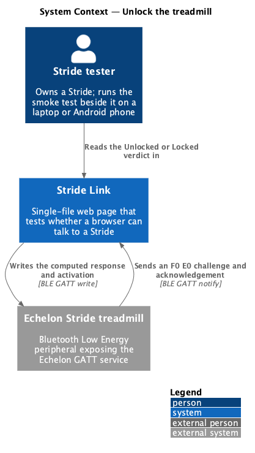
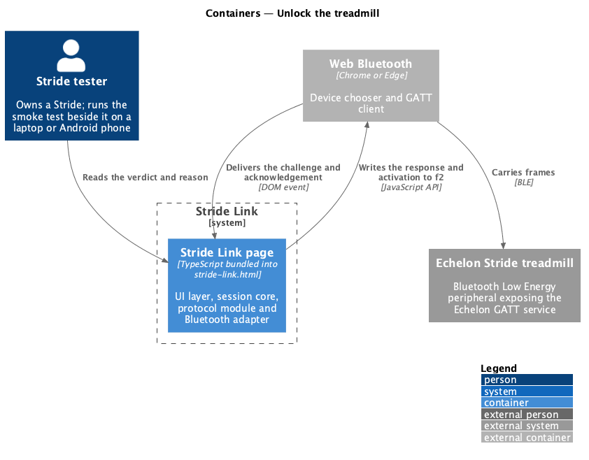
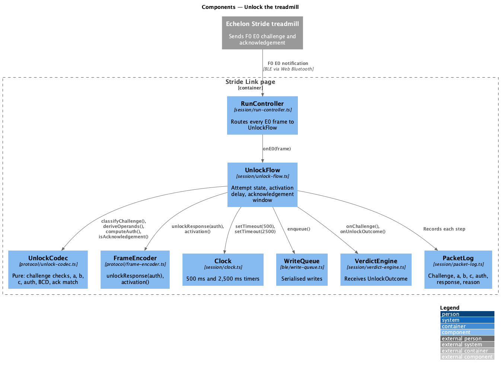
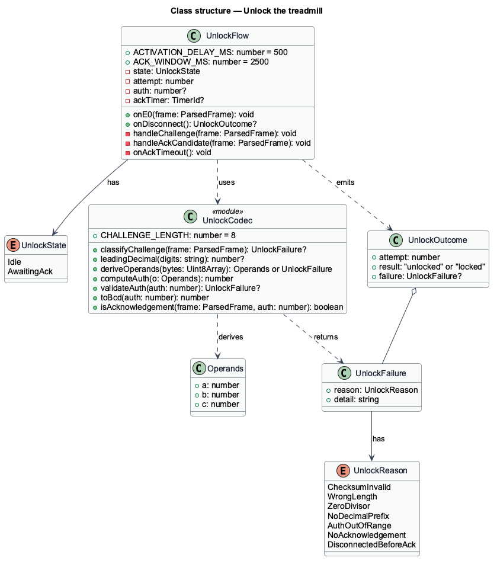
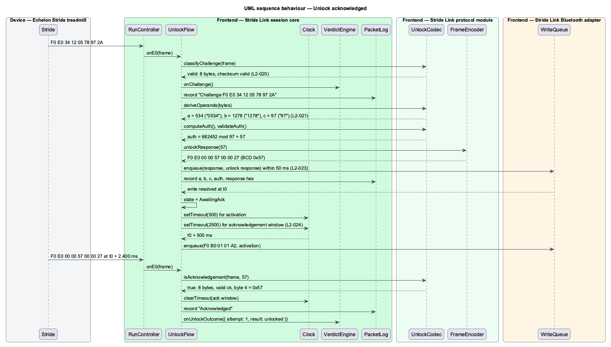
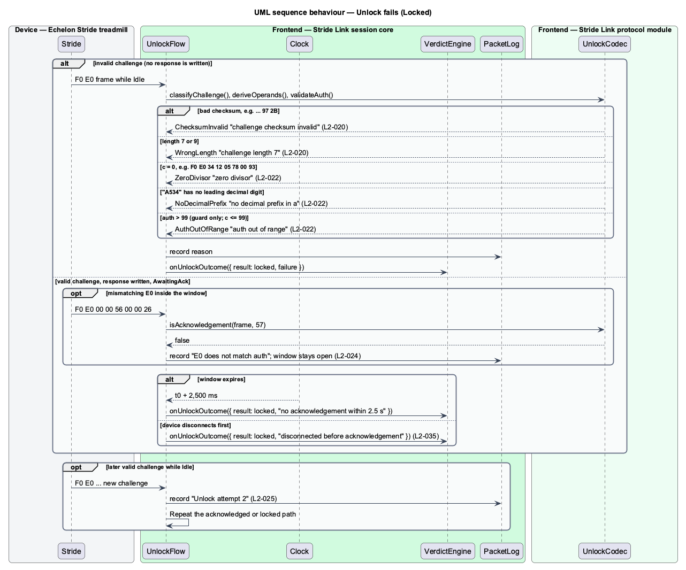

# Unlock the treadmill

## Overview

Some Echelon equipment is locked. It refuses to talk until it receives the correct response to a challenge. ADR 0011 assumed the response needed the official Echelon app. qdomyos-zwift has since published a direct challenge/response algorithm, credited to Christian Emerson, that computes the response locally.

- **challenge** — 8-byte notification `F0 E0 b2 b3 b4 b5 b6 ck` with a valid checksum, received while no acknowledgement is awaited
- **auth** — number from 0 to 99, equal to (a x b) mod c, derived from the challenge bytes
- **leading decimal run** — longest prefix of a hex digit string made only of the digits 0 to 9, read as a base-10 integer
- **response** — frame `F0 E0 00 00 BCD(auth) 00 00 ck`, with the tens digit of auth in the high nibble
- **activation** — frame `F0 B0 01 01 A2`, written 500 ms after the response
- **acknowledgement** — 8-byte `F0 E0` notification with a valid checksum whose byte 4 equals `BCD(auth)`, received within 2,500 ms of the response write
- **unlock attempt** — one challenge and its response, activation and acknowledgement window

Stride Link uses this unlock only on equipment the tester owns. The PRD records it as a risk, because the unlock is Echelon's access control.

## Description

- **`UnlockFlow`** — receives every inbound `E0` frame from `RunController` through `onE0(frame)`. Its behaviour depends on `UnlockState`:
  - **`Idle`** — the frame is a challenge candidate. `UnlockCodec.classifyChallenge()` checks length and checksum. `deriveOperands()`, `computeAuth()` and `validateAuth()` then produce auth or an `UnlockFailure`. On success, the response is enqueued within 50 ms, tagged `unlock response`. Once the write resolves, the state becomes `AwaitingAck` and two timers start: 500 ms for the activation and 2,500 ms for the acknowledgement window.
  - **`AwaitingAck`** — the frame is an acknowledgement candidate. A match clears the window timer and reports `unlocked`. A mismatch is logged as `E0 does not match auth`, and the window stays open. A mismatch never counts as a new challenge.

  A match before the activation is written still counts, and the activation is still written. Expiry of the window reports `locked` with `no acknowledgement within 2.5 s`. `onDisconnect()` while awaiting reports `locked` with `disconnected before acknowledgement`.
- **Attempts** — a valid challenge that arrives after a window has closed starts attempt n + 1, logged as `Unlock attempt n`. The latest attempt decides the verdict (L2-025). A challenge that arrives during init starts the flow at once. Its writes share `WriteQueue` with the remaining init frames.
- **`UnlockCodec`** — pure arithmetic.
  - `leadingDecimal("0534")` is 534, `leadingDecimal("3A34")` is 3, and `leadingDecimal("A534")` is null.
  - a comes from hex(b4)+hex(b2), b from hex(b3)+hex(b5), and c from hex(b6).
  - Failures, in check order: `ChecksumInvalid`, `WrongLength`, `NoDecimalPrefix` (naming a, b or c), `ZeroDivisor`, `AuthOutOfRange`.
  - The product a x b is at most 9,999 x 9,999, so it stays within safe integer range.
  - c has at most two decimal digits, so auth is at most 98. `validateAuth` still guards the over-99 case, and that guard is unit-tested directly.
- **Worked example** — challenge `F0 E0 34 12 05 78 97 2A` gives a = 534, b = 1278 and c = 97. That makes auth = 682,452 mod 97 = 57, and the response is `F0 E0 00 00 57 00 00 27`. Challenge `F0 E0 10 20 30 40 50 C0` gives auth = 0 and the response `F0 E0 00 00 00 00 00 D0`.
- **Invalid challenges** — no response is written. The verdict is **Locked**, and the reason appears next to the verdict and in the log (L2-022).
- **`UnlockOutcome`** — `{ attempt, result, failure? }`, passed to `VerdictEngine.onUnlockOutcome()`. `onChallenge()` tells `VerdictEngine` that a challenge was seen, which suppresses **Talks**.
- **Logging** — the challenge hex, a, b, c and auth in decimal, the response hex, `Acknowledged`, and every failure reason.

The PRD lists unlock envelope variants as a fallback risk. They are out of scope. Every `E0` frame is logged, so a variant can be identified from the export.

## Requirements

The feature realizes the following level-2 (L2) requirements. Each L2 requirement refines a level-1 (L1) requirement, cited by identifier.

| L2 ID | Refines (L1) | Requirement |
|-------|--------------|-------------|
| `L2-020` | `L1-005` | An 8-byte inbound frame beginning `F0 E0` with a valid checksum, received while no acknowledgement is awaited, is an unlock challenge. Every inbound `E0` frame must be logged. |
| `L2-021` | `L1-005` | From challenge `F0 E0 b2 b3 b4 b5 b6 ck`, each byte is written as two uppercase hex digits. `a` is the leading run of decimal digits of hex(b4)+hex(b2), `b` is the leading run of hex(b3)+hex(b5), and `c` is the leading run of hex(b6), each read as a base-10 integer. auth = (a x b) mod c. |
| `L2-022` | `L1-005` | A challenge that cannot produce a valid auth must end in **Locked** with a logged reason, and no response is written. |
| `L2-023` | `L1-005` | For a valid challenge, the system must write `F0 E0 00 00 BCD(auth) 00 00 ck`, with the tens digit of auth in the high nibble, and then write activation `F0 B0 01 01 A2` 500 ms after the response write resolves. |
| `L2-024` | `L1-005` | After the response write resolves, the system must wait 2,500 ms for an acknowledgement: an 8-byte `F0 E0` notification with a valid checksum whose byte 4 equals BCD(auth). |
| `L2-025` | `L1-005` | A new challenge received after an acknowledgement window has closed must start a new, numbered unlock attempt. The verdict reflects the latest attempt. |

## Diagrams

### System context

The treadmill challenges Stride Link and acknowledges a correct response. The tester reads the outcome as **Unlocked** or **Locked**.

### Containers

Challenge, response, activation and acknowledgement all travel through the Web Bluetooth container.

### Components

`UnlockFlow` owns timing and state. `UnlockCodec` owns arithmetic, and `FrameEncoder` builds the frames. Outcomes go to `VerdictEngine`.

### Class structure

`UnlockFlow` holds an `UnlockState` and emits `UnlockOutcome`. `UnlockCodec` returns `Operands` or an `UnlockFailure` carrying an `UnlockReason`.

### Behaviour — unlock acknowledged

The worked example runs end to end: challenge, auth 57, response, activation at +500 ms, and a matching acknowledgement at +2,400 ms.

### Behaviour — unlock fails

The diagram covers each invalid-challenge reason, a mismatching acknowledgement, window expiry, disconnection, and a later challenge that starts a new attempt.

