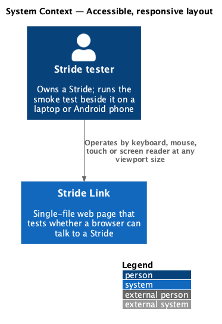
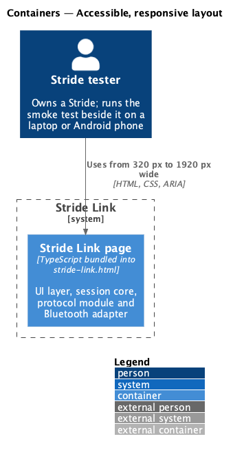
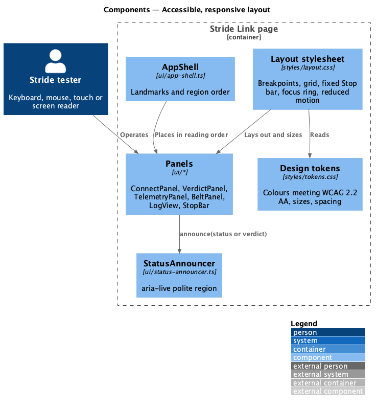
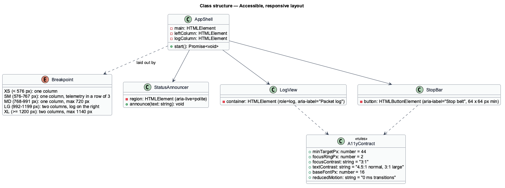
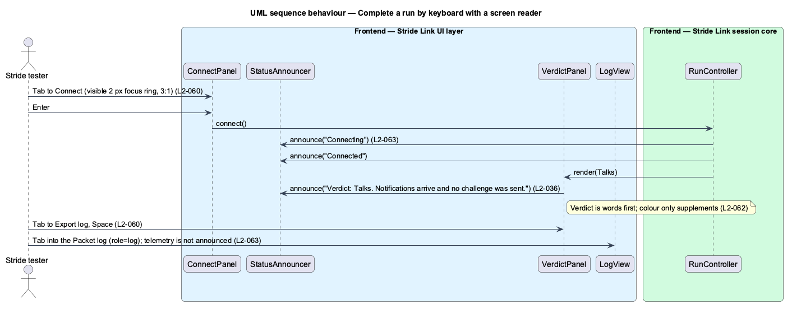
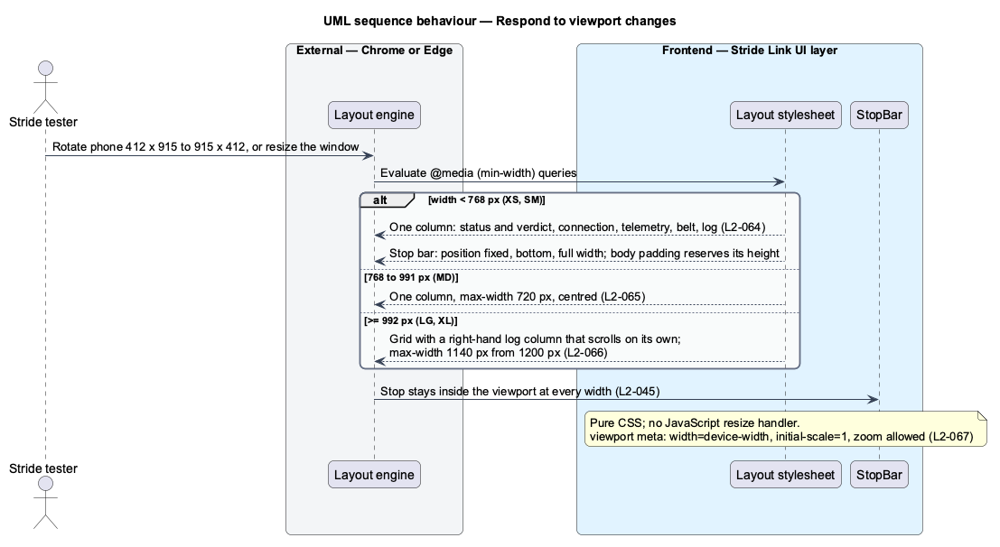

# Accessible, responsive layout

## Overview

Testers stand next to a treadmill with either a laptop or an Android phone. The page therefore works from a 320 px phone in portrait to a wide desktop window. It is fully operable by keyboard, touch and screen reader, and meets WCAG 2.2 AA.

- **breakpoint** — viewport width at which the layout changes: XS (under 576 px), SM (576 px), MD (768 px), LG (992 px) and XL (1200 px)
- **live region** — element whose text changes are announced by screen readers, here with `aria-live="polite"`
- **target size** — clickable area of an interactive control, at least 44 x 44 CSS px here

This feature is cross-cutting. It defines the layout and the accessibility rules that every panel in the other features follows.

## Description

- **Layout stylesheet (`styles/layout.css`)** — mobile-first CSS with `min-width` media queries and no JavaScript resize handling:

  | Breakpoint | Layout |
  |------------|--------|
  | XS, under 576 px | One column in the order status and verdict, connection controls, telemetry, belt controls, log |
  | SM, 576 px to 767 px | As XS; telemetry shows speed, incline and heart rate in one row of three |
  | MD, 768 px to 991 px | One column, at most 720 px wide, centred |
  | LG, 992 px to 1199 px | Two columns: status, verdict, telemetry and controls on the left; the log on the right, scrolling on its own |
  | XL, 1200 px and up | As LG, at most 1140 px wide, centred |

  Below 768 px, Stop is a full-width bar fixed to the bottom of the viewport, and the body reserves its height so no content is permanently hidden. Long hex lines wrap between bytes or scroll inside the log container, never the page.
- **Design tokens (`styles/tokens.css`)** — colours meeting 4.5:1 for normal text, 3:1 for large text and 3:1 for UI boundaries. Base text is 16 px. Verdict colours supplement the verdict word.
- **`AppShell`** — renders the landmarks (`header`, `main`, the log column) in reading order, so the Tab order matches the visual order at every breakpoint.
- **Focus** — every interactive control shows a focus ring at least 2 CSS px thick with 3:1 contrast. No element traps focus.
- **Targets** — every control is at least 44 x 44 CSS px, and Stop is at least 64 x 64. No function depends on hover.
- **Labels and announcements** — every input and button has an accessible name matching its visible label. `StatusAnnouncer` announces connecting, connected, errors, disconnected and verdicts. Telemetry is not announced. `LogView` has `role="log"` and the name `Packet log`.
- **Motion** — under `prefers-reduced-motion: reduce`, every transition and animation runs for 0 ms.
- **Viewport** — the meta tag is `width=device-width, initial-scale=1`, without `user-scalable=no` or `maximum-scale`. At 200 % zoom on a 1280 px window, the layout falls back to one column without horizontal page scroll.
- **Verification** — axe-core runs in the acceptance suite only, in every state: idle, unsupported, connecting, each verdict, gate open, belt active and error. Zero serious or critical violations are allowed. axe-core is not shipped.

## Requirements

The feature realizes the following level-2 (L2) requirements. Each L2 requirement refines a level-1 (L1) requirement, cited by identifier.

| L2 ID | Refines (L1) | Requirement |
|-------|--------------|-------------|
| `L2-060` | `L1-013` | Every control must be reachable and operable by keyboard, with a visible focus indicator. |
| `L2-061` | `L1-013` | Every interactive control must have a target of at least 44 x 44 CSS px, and every function must work without hover. |
| `L2-062` | `L1-013` | Verdicts and states must be conveyed in words, and colours must meet WCAG 2.2 AA contrast. |
| `L2-063` | `L1-013` | All controls must have programmatic labels, status changes must be announced, and motion must respect user preference. |
| `L2-064` | `L1-014` | Below 768 px the page must use one column, in the order status and verdict, connection controls, telemetry, belt controls, log. Stop must be a full-width bar fixed to the bottom of the viewport while the belt is active. |
| `L2-065` | `L1-014` | At MD the page must keep a single column with content width capped for readability. |
| `L2-066` | `L1-014` | At LG and XL the page must show two columns: status, verdict, telemetry and controls on the left, and the log on the right. |
| `L2-067` | `L1-014` | The page must work in portrait and landscape and must allow zoom. |

## Diagrams

### System context

The tester operates Stride Link by keyboard, mouse, touch or screen reader at any viewport size.

### Containers

The layout lives entirely within the page. The context and container views carry the same facts for this slice, and the component view holds the detail.

### Components

The layout stylesheet and design tokens shape every panel. `AppShell` fixes the reading order, and `StatusAnnouncer` carries announcements.

### Class structure

`AppShell` places the announcer, the log and the Stop bar. `Breakpoint` and `A11yContract` record the layout and accessibility rules.

### Behaviour — complete a run by keyboard

A keyboard and screen-reader tester connects, hears the status and the verdict, and exports the log without a pointer.

### Behaviour — respond to viewport changes

Media queries alone switch between the one-column and two-column layouts. Stop stays inside the viewport throughout.

