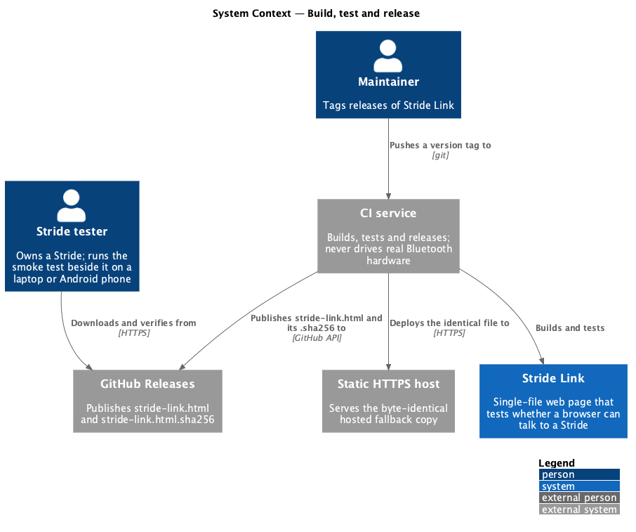
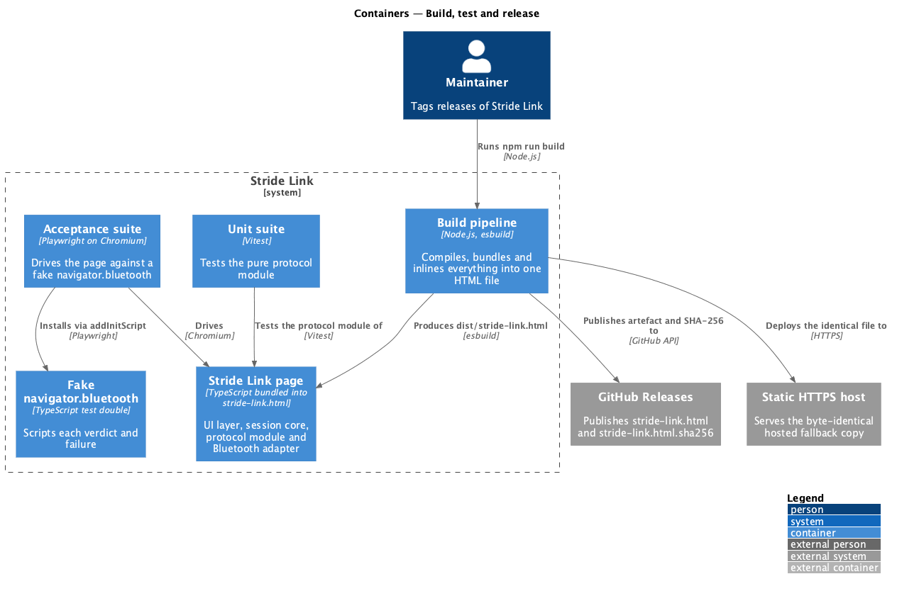
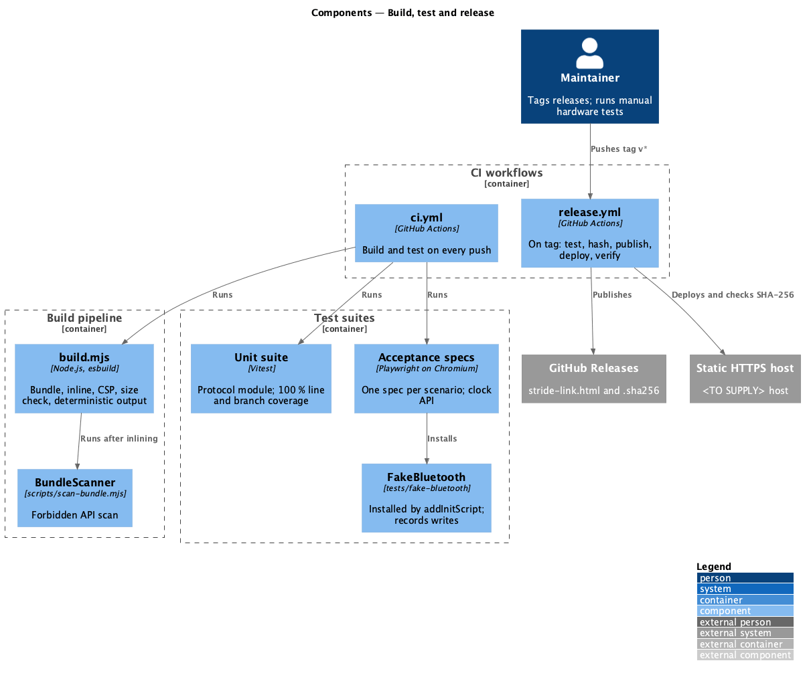
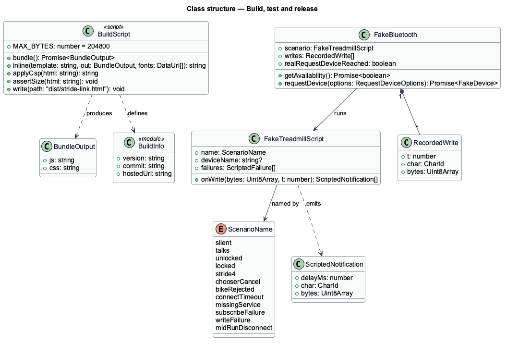
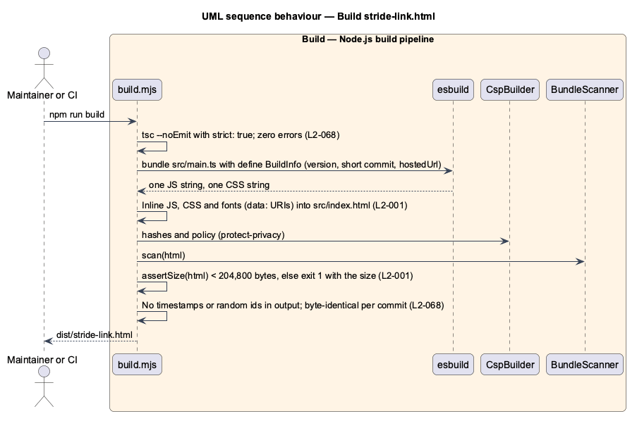
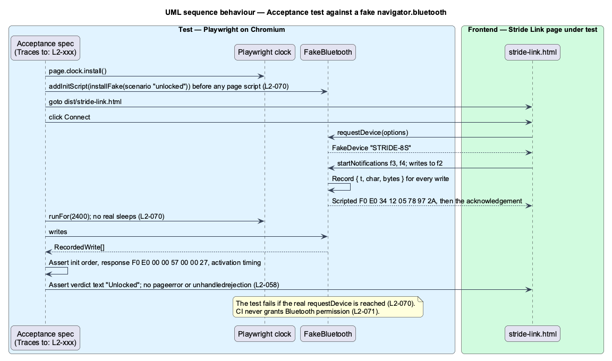
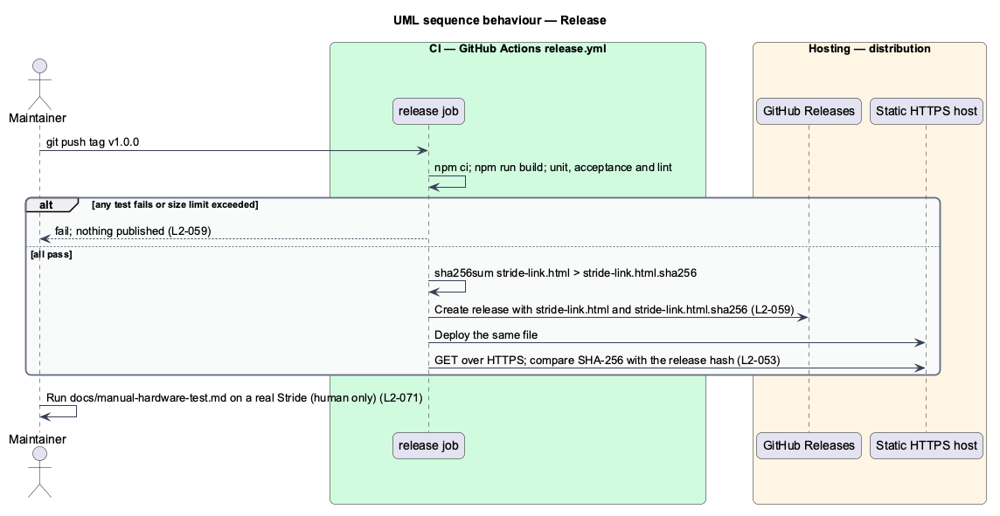

# Build, test and release

## Overview

Stride Link ships as one self-contained file, `stride-link.html`, attached to a GitHub release with its SHA-256. The same file is served from a static HTTPS host. The source is strict TypeScript, compiled and bundled into that one file.

Two test suites guard it:

- a unit suite over the pure protocol module;
- an acceptance suite that drives the real page against a fake `navigator.bluetooth`.

Real hardware is tested only by a person.

- **fake `navigator.bluetooth`** — test double installed before any page script runs, which scripts a treadmill's replies and records every write
- **scenario** — named script for the fake that produces one verdict or one failure
- **deterministic build** — build whose output is byte-identical for the same commit
- **manual hardware checklist** — written procedure a person follows to test a real Stride safely

Where the code lives is an open question in the PRD. Wattzup's `AGENTS.md` allows one application only, so the repository home is `<TO SUPPLY>`.

## Description

- **`build.mjs`** — `npm run build`:
  1. Runs `tsc --noEmit` with `strict: true` and fails on any error.
  2. Bundles `src/main.ts` with esbuild, defining `BuildInfo` (version from `package.json`, short commit hash, hosted URL).
  3. Inlines the JS, the CSS and any fonts (as `data:` URIs) into `src/index.html`.
  4. Writes the CSP (`protect-privacy`) and runs `BundleScanner`.
  5. Asserts the result is smaller than 204,800 bytes, or exits 1 with the actual size.
  6. Writes `dist/stride-link.html`.

  The output contains no timestamps or random identifiers, so the build is deterministic. The page footer and the export header show the version and commit.
- **Unit suite (Vitest)** — `tests/unit/protocol/`.
  - One test per PRD frame: A4, A1, A3, Stride 4 E0, E0 challenge, E0 response, B0 activate, start and stop, A0, B2, B1, D3, D2, D0 and D1.
  - One test per unlock case: valid, auth 0, zero divisor, no decimal prefix in a, b and c, auth out of range, bad checksum, wrong length, and matching and mismatching acknowledgement.
  - The 10,000-array parser fuzz test.
  - Coverage of the protocol module is 100 % for lines and branches.
- **Acceptance suite (Playwright on Chromium)** — `tests/acceptance/`. Each spec file opens with the trace comment, for example `// Traces to: L2-024, L2-033`.
  - Each test installs the fake with `addInitScript` and controls time with `page.clock`. No test uses real sleeps.
  - Each test fails on any `pageerror` or `unhandledrejection`.
- **`FakeBluetooth`** — implements `getAvailability()` and `requestDevice()` and returns fake devices, services and characteristics. Every write is recorded as `{ t, char, bytes }`. `realRequestDeviceReached` is checked after every test.
- **`FakeTreadmillScript`** — one per `ScenarioName`: `silent`, `talks`, `unlocked`, `locked`, `stride4`, `chooserCancel`, `bikeRejected`, `connectTimeout`, `missingService`, `subscribeFailure`, `writeFailure` and `midRunDisconnect`. `onWrite()` returns the notifications to emit, with delays.
- **CI** — GitHub Actions. `ci.yml` builds and runs lint, unit and acceptance tests on every push. `release.yml` runs on a `v*` tag:
  1. Repeats the CI checks.
  2. Writes `stride-link.html.sha256` with `sha256sum`.
  3. Creates the GitHub release with both assets.
  4. Deploys the same file to the static host and compares its served SHA-256 with the release hash.

  Any failure publishes nothing. No job grants Bluetooth permission or touches real hardware.
- **Manual hardware testing** — `docs/manual-hardware-test.md` lists, in order: safety key in reach, tester standing clear, browser and OS recorded, run to verdict, export log, and belt checks at or below 3 km/h. The repository's `AGENTS.md` states that agents shall not run hardware tests or press belt controls on real equipment.

The choice of esbuild and Vitest is a design decision of this document; the PRD names only TypeScript and Playwright. The static host is `<TO SUPPLY>`.

## Requirements

The feature realizes the following level-2 (L2) requirements. Each L2 requirement refines a level-1 (L1) requirement, cited by identifier.

| L2 ID | Refines (L1) | Requirement |
|-------|--------------|-------------|
| `L2-001` | `L1-001` | The release artefact must be one file named `stride-link.html`, smaller than 200 KB (204,800 bytes). It must inline all scripts, styles, fonts and images, and must reference no external resource. |
| `L2-059` | `L1-015` | Each release must publish `stride-link.html` with a matching SHA-256. |
| `L2-068` | `L1-015` | The source must be strict TypeScript, compiled and bundled into the single HTML file by one reproducible command. |
| `L2-070` | `L1-015` | The acceptance suite must run on Chromium against a scriptable fake `navigator.bluetooth`, installed before page scripts run, with a controllable clock. |
| `L2-071` | `L1-015` | Tests against a real treadmill must be run only by a person, following a written checklist. CI and agents must never drive real Bluetooth hardware. |

## Diagrams

### System context

The maintainer tags a release. CI builds, tests and publishes the file to GitHub Releases and the static host, where testers download and verify it.

### Containers

The build pipeline produces the page, and both test suites exercise it. The pipeline publishes the same artefact to both distribution points.

### Components

`ci.yml` runs the build and both suites. `release.yml` publishes and verifies. The acceptance specs install `FakeBluetooth`.

### Class structure

`BuildScript` produces `BundleOutput` and defines `BuildInfo`. `FakeBluetooth` runs a `FakeTreadmillScript` and records `RecordedWrite` items.

### Behaviour — build

The build type-checks, bundles, inlines, applies the CSP, scans, checks the size and writes one deterministic file.

### Behaviour — acceptance test

A spec installs the fake before the page loads, runs a scenario on the fake clock, and asserts on the recorded writes and the visible verdict.

### Behaviour — release

A tag triggers the full checks, hashing, publication, deployment and a post-deploy hash comparison. The manual hardware checklist follows, run by a person.

