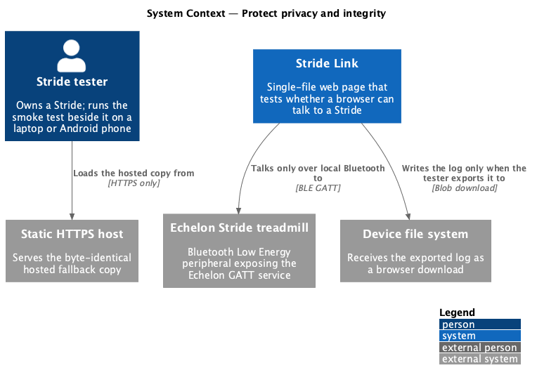
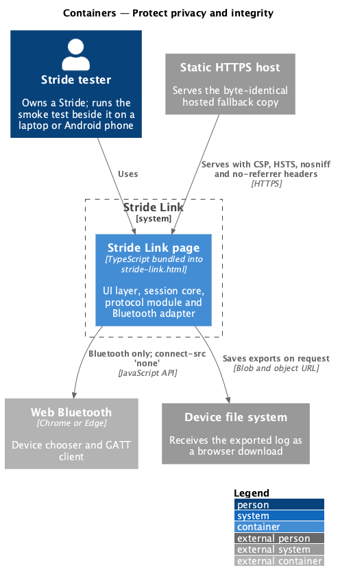
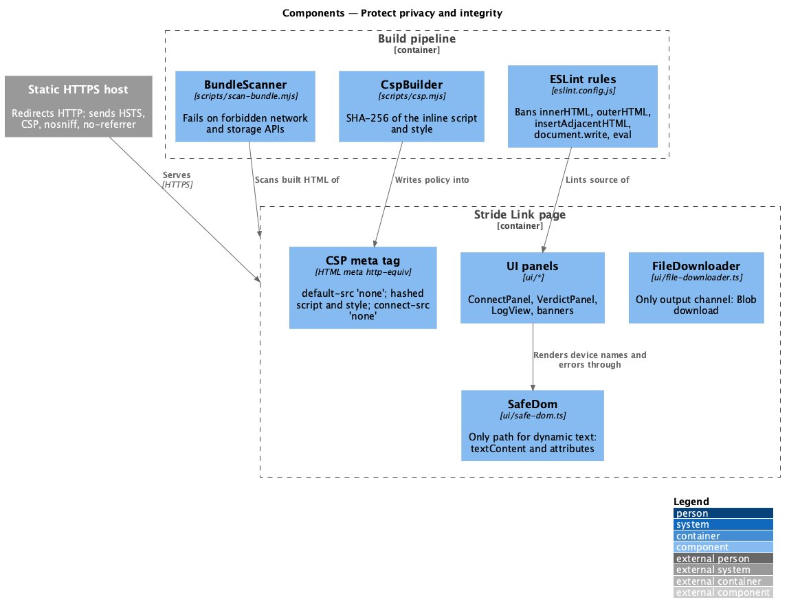
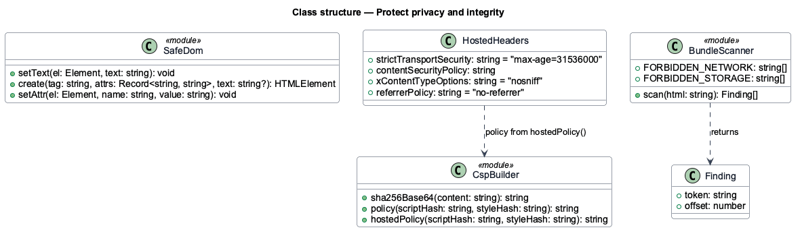
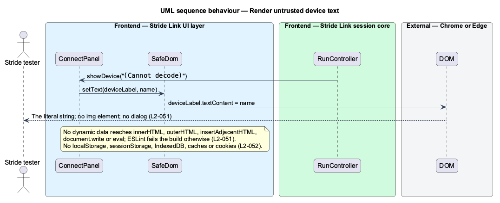
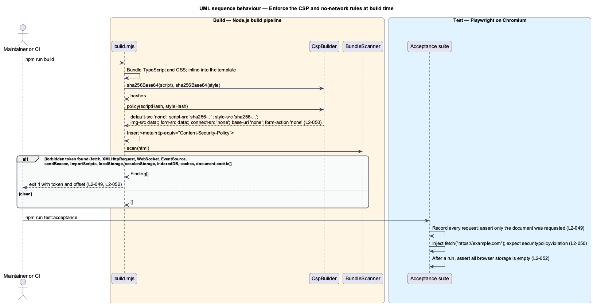
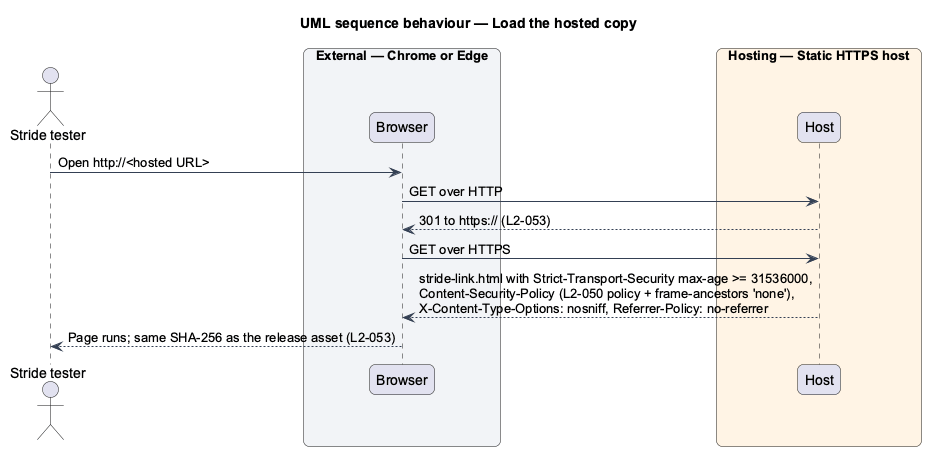

# Protect privacy and integrity

## Overview

Like Wattzup, Stride Link sends nothing off the device. It has no backend, no analytics and no network request. Its only channels are local Bluetooth to the treadmill and a file download the tester asks for.

The page also handles untrusted input. Device names come from radio advertisements, and error messages can carry device-supplied text. Neither can execute.

- **Content Security Policy (CSP)** — browser-enforced allow-list of the sources a page may load or connect to
- **hash source** — CSP entry `'sha256-<digest>'` that allows exactly one inline script or style whose contents match the digest
- **bundle scan** — build-time search of the final HTML for forbidden network and storage APIs
- **hosted copy** — byte-identical `stride-link.html` on a static HTTPS host, used when a browser blocks Bluetooth on `file://` pages

## Description

- **CSP meta tag** — `<meta http-equiv="Content-Security-Policy">` in the built page:

  ```
  default-src 'none'; script-src 'sha256-<script hash>'; style-src 'sha256-<style hash>';
  img-src data:; font-src data:; connect-src 'none'; base-uri 'none'; form-action 'none'
  ```

  It has neither `'unsafe-inline'` nor `'unsafe-eval'`. The markup has no inline `style` or `on*` attributes. Dynamic styling uses classes and CSSOM property assignment, which a CSP does not restrict.
- **`CspBuilder`** — build-time module. `sha256Base64()` hashes the single inline script and the single inline style after inlining. `policy()` produces the meta value. `hostedPolicy()` adds `frame-ancestors 'none'`, which only works as an HTTP header.
- **`BundleScanner`** — fails the build on any of `fetch`, `XMLHttpRequest`, `WebSocket`, `EventSource`, `navigator.sendBeacon`, `importScripts`, `localStorage`, `sessionStorage`, `indexedDB`, `caches` or `document.cookie` in the built HTML (L2-049, L2-052). The page has no runtime dependencies, so a hit always points at project code.
- **`SafeDom`** — the only path for dynamic text. `setText()` assigns `textContent`, and `create()` builds elements with attributes and text nodes. A device named `` renders as that literal string (L2-051).
- **ESLint rules** — `no-restricted-properties` and `no-restricted-syntax` ban `innerHTML`, `outerHTML`, `insertAdjacentHTML`, `document.write` and `eval`. A violation fails the build.
- **No persistence** — no browser storage is used. The log lives in memory and is gone when the tab closes (L2-052).
- **Hosted copy headers** — `HostedHeaders` lists what the host sends: an HTTP-to-HTTPS redirect, `Strict-Transport-Security: max-age=31536000`, the hosted CSP, `X-Content-Type-Options: nosniff` and `Referrer-Policy: no-referrer`. The host and its header configuration format are `<TO SUPPLY>`. The PRD leaves open where the release lives.
- **Integrity** — the hosted file's SHA-256 equals the release hash. The release workflow checks this after deployment (`build-test-release`).
- **Acceptance checks** — Playwright records every request and asserts that only the document was requested. It asserts that an injected `fetch("https://example.com")` raises `securitypolicyviolation`, and that all browser storage is empty after a run and an export.

## Requirements

The feature realizes the following level-2 (L2) requirements. Each L2 requirement refines a level-1 (L1) requirement, cited by identifier.

| L2 ID | Refines (L1) | Requirement |
|-------|--------------|-------------|
| `L2-049` | `L1-011` | After the document itself loads, the page must make zero network requests. |
| `L2-050` | `L1-011` | The page must declare a restrictive CSP in a `<meta http-equiv="Content-Security-Policy">` tag that allows inline code only by hash and allows no other origin. |
| `L2-051` | `L1-011` | Device names, error messages and log text must be inserted only as text nodes. |
| `L2-052` | `L1-011` | The page must store nothing in the browser between loads. |
| `L2-053` | `L1-011` | The hosted fallback must be served only over HTTPS, with security headers. |

## Diagrams

### System context

Stride Link talks only to the treadmill over local Bluetooth and writes to the file system only on export. The hosted copy is loaded over HTTPS only.



### Containers

The host serves the page with security headers. The page's CSP allows Bluetooth and Blob downloads but no network connection.



### Components

At build time, `CspBuilder`, `BundleScanner` and the ESLint rules enforce the rules. At run time, `SafeDom` is the only path for dynamic text.



### Class structure

The build-time modules and the hosted header set are the structural parts of this slice. `HostedHeaders` takes its policy from `CspBuilder`.



### Behaviour — render untrusted device text

An unsafe device name passes through `SafeDom` into `textContent` and appears as literal text.



### Behaviour — build-time and acceptance checks

The build writes the hashed CSP and scans for forbidden APIs. The acceptance suite then proves no request is made and storage stays empty.



### Behaviour — load the hosted copy

HTTP redirects to HTTPS. The HTTPS response carries the security headers and the same bytes as the release asset.


