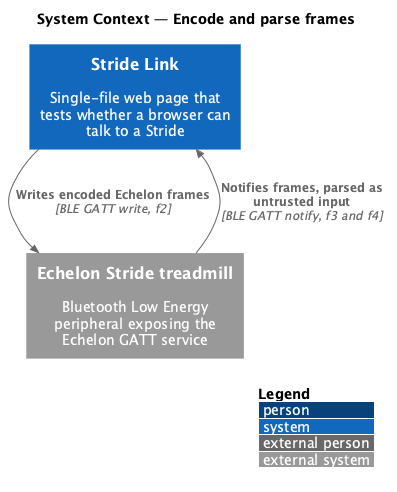
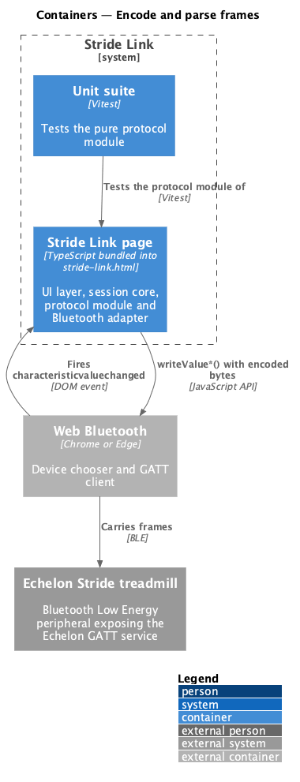
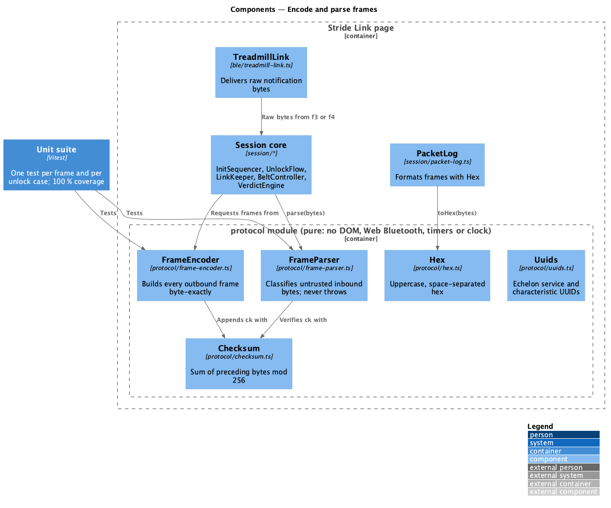
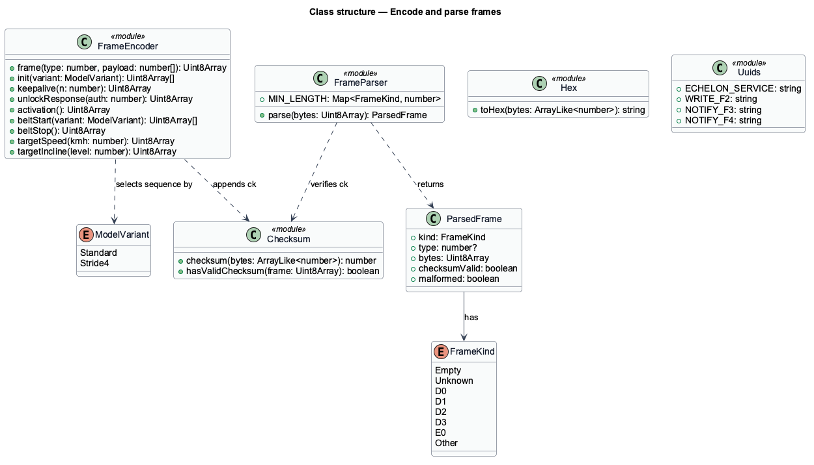
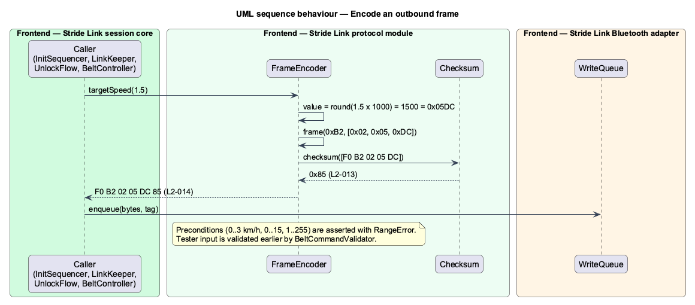
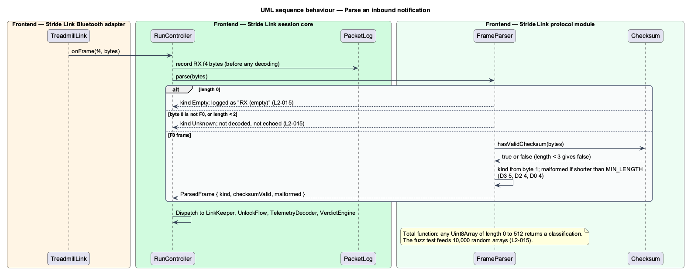

# Encode and parse frames

## Overview

An Echelon Stride speaks a byte-oriented protocol. Every message is a frame, and every frame has the same shape.

- **frame** — byte array whose byte 0 is `F0`, whose byte 1 is the frame type, and whose last byte is the checksum
- **checksum (`ck`)** — sum of all preceding bytes of a frame, modulo 256
- **TX frame** — frame written by Stride Link to `f2`
- **RX frame** — frame notified by the treadmill on `f3` or `f4`

This feature is the protocol codec: the pure module that every other feature uses to build outbound frames and classify inbound ones. Pure means it has no DOM, Web Bluetooth, timer or clock access. That lets the unit suite test every frame and every unlock case directly.

Inbound bytes come from a radio and are untrusted input. The parser classifies any byte array and never throws. All protocol facts are Observed from qdomyos-zwift `a23bb20` and are not yet confirmed on a Stride.

## Description

- **`Checksum`** — `checksum(bytes)` returns the sum of the bytes modulo 256. `hasValidChecksum(frame)` compares the last byte with the checksum of the bytes before it. Frames shorter than 3 bytes are reported invalid without throwing.
- **`FrameEncoder`** — one function per outbound frame. Each builds `F0`, the type and the payload, and then appends `ck`:

  | Function | Output |
  |----------|--------|
  | `init(Standard)` | `F0 A4 00 94`, `F0 A1 00 91` x4, `F0 A3 00 93`, `F0 A1 00 91` |
  | `init(Stride4)` | `F0 A4 00 94` x2, `F0 E0 FD 3E 65 48 D5 8D`, `F0 A4 00 94`, `F0 A1 00 91` x4, `F0 A3 00 93` |
  | `keepalive(n)` | `F0 A0 01 n ck`; `n` = 1 gives `… 01 92`, `n` = 255 gives `… FF 90` |
  | `unlockResponse(auth)` | `F0 E0 00 00 BCD(auth) 00 00 ck`; auth 57 gives `F0 E0 00 00 57 00 00 27` |
  | `activation()` | `F0 B0 01 01 A2` |
  | `beltStart(Standard)` | `F0 B0 01 01 A2`, `F0 D0 01 00 C1`, `F0 D0 01 11 D2` |
  | `beltStart(Stride4)` | the three above, then `F0 A5 00 95`, `F0 D3 02 01 F4 BA` |
  | `beltStop()` | `F0 B0 01 00 A1` |
  | `targetSpeed(kmh)` | `F0 B2 02 hi lo ck` with `hi lo` = round(kmh x 1000); 3.0 gives `… 0B B8 67` |
  | `targetIncline(level)` | `F0 B1 01 n ck`; 15 gives `F0 B1 01 0F B1` |

  Out-of-range arguments raise `RangeError`. These are programmer errors, because tester input is validated earlier by `BeltCommandValidator`.
- **`FrameParser`** — `parse(bytes)` returns a `ParsedFrame`:
  - An empty array is `Empty`.
  - An array of length under 2, or whose byte 0 is not `F0`, is `Unknown`.
  - Otherwise `kind` comes from byte 1 (`D0`, `D1`, `D2`, `D3`, `E0`, or `Other`), and `checksumValid` comes from `Checksum`.
  - `malformed` is set when the frame is shorter than `MIN_LENGTH` for its kind: D3 5, D2 4, D0 4.
- **`ParsedFrame`** — `kind`, `type`, `bytes`, `checksumValid` and `malformed`. Decoding of fields belongs to `TelemetryDecoder` and `UnlockCodec`.
- **`Hex`** — `toHex(bytes)` returns two uppercase hex digits per byte, separated by single spaces. An empty array gives the empty string.
- **`Uuids`** — the Echelon service and the `f2`, `f3` and `f4` characteristic UUIDs.

The module lives under `src/protocol/`. It does not reference `window`, `document`, `navigator`, `setTimeout`, `setInterval`, `Date` or `performance`, and a static check enforces this. The unit suite holds one test per frame in the PRD frame table and one per unlock case, with 100 % line and branch coverage (L2-069).

## Requirements

The feature realizes the following level-2 (L2) requirements. Each L2 requirement refines a level-1 (L1) requirement, cited by identifier.

| L2 ID | Refines (L1) | Requirement |
|-------|--------------|-------------|
| `L2-013` | `L1-003` | The checksum of a frame must be the sum of all preceding bytes modulo 256. |
| `L2-014` | `L1-003` | Every outbound frame must be built by the protocol module and must match these bytes exactly. |
| `L2-015` | `L1-003` | The parser must classify every inbound frame by type and must never throw, whatever bytes arrive. |
| `L2-016` | `L1-003` | All frames shown on screen and in the export must use the same hex format. |
| `L2-069` | `L1-015` | All frame encoding, parsing, checksum, unlock arithmetic and telemetry decoding must live in a pure module with no DOM, Web Bluetooth, timer or clock access. There must be a unit test per frame and per unlock case. |

## Diagrams

### System context

Stride Link writes encoded frames to the treadmill and receives notified frames, which it treats as untrusted input.

### Containers

The page exchanges raw bytes with the Web Bluetooth container. The unit suite tests the protocol module inside the page's source.

### Components

The session core asks `FrameEncoder` for frames and passes raw bytes to `FrameParser`. Both use `Checksum`, and `PacketLog` formats bytes with `Hex`.

### Class structure

`FrameParser` returns `ParsedFrame`, which carries a `FrameKind`. `FrameEncoder` selects its sequences by `ModelVariant`.

### Behaviour — encode an outbound frame

A target speed of 1.5 km/h becomes `F0 B2 02 05 DC 85`. The diagram shows the payload, the checksum and the hand-off to `WriteQueue`.

### Behaviour — parse an inbound notification

Every notification is logged before it is parsed. The parser's four outcomes are empty, unknown, malformed, and a classified frame.

